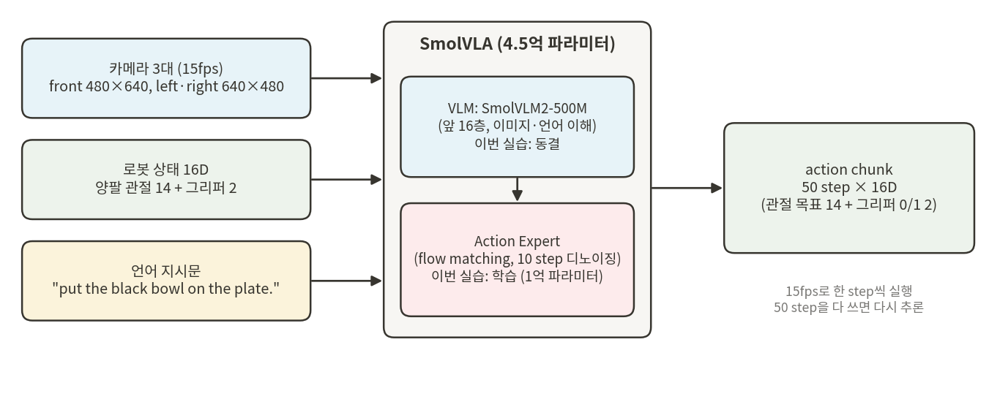
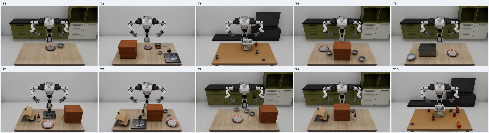

# RB-Y1 T1~T10에서 SmolVLA 학습 및 평가

---

# 0️⃣ VLA와 SmolVLA란?

<https://huggingface.co/blog/smolvla>
<https://huggingface.co/lerobot/smolvla_base>
<https://github.com/huggingface/lerobot>

**VLA(Vision-Language-Action) 모델**은 카메라 영상(Vision)과 언어 지시문(Language)을 함께 보고 로봇 동작(Action)을 바로 출력하는 정책입니다. IL 실습의 BC 정책은 task 하나만 배웠지만, VLA는 지시문을 바꿔 가며 **모델 하나로 여러 task**를 수행합니다.

**SmolVLA**는 Hugging Face LeRobot 팀이 공개한 작은 VLA입니다(전체 4.5억 파라미터). 영상·언어를 이해하는 VLM(SmolVLM2-500M의 앞 16층)과, 그 정보를 받아 로봇 동작을 만드는 **action expert**로 이루어져 있습니다. action expert는 flow matching으로 한 번에 50 step 분량의 동작 묶음(**action chunk**)을 만듭니다. `lerobot/smolvla_base`는 커뮤니티 로봇 데이터로 미리 학습된 가중치이고, 이번 실습에서는 이것을 우리 RB-Y1 시뮬레이션 데이터로 **미세조정(fine-tuning)** 합니다.

이번 실습의 입력과 출력은 다음과 같습니다.



| 구분 | 내용 |
|---|---|
| 입력 영상 | `front`(머리 카메라 480×640), `left`·`right`(손목 카메라 640×480 세로) |
| 입력 상태 | 16차원: 오른팔 관절 7, 왼팔 관절 7, 오른손·왼손 그리퍼 열림 정도(0~1) |
| 입력 언어 | task의 지시문 (예: `put the black bowl on the plate.`) |
| 출력 | 16차원 action × 50 step. 팔은 다음 step의 절대 관절 목표(rad), 그리퍼는 열기 1 / 닫기 0 |

전체 흐름: **오라클로 시범 수집 → LeRobot 데이터셋 변환·검증 → SmolVLA 학습 → task마다 50회 평가**

---

# 0️⃣ 환경 확인

**1. Course version이 고정되었는가?**

```bash
conda activate lerobot-arena
cd ~/lightwheel_rby1_transfer
git checkout vla-lab-v1
./vla_lab/check_env.sh
```

조교 PC 출력:

```text
========== Python ==========
Python 3.11.16

========== PyTorch ==========
PyTorch: 2.7.0+cu128
CUDA: 12.8
GPU: NVIDIA GeForce RTX 3090

========== Isaac Sim ==========
isaacsim: 5.1.0.0
isaacsim-core: 5.1.0.0
isaacsim-app: 5.1.0.0

========== IsaacLab ==========
Path: /home/cai/IsaacLab_RS
VERSION: 2.3.0
e83a5d2 Update play_one_episode.py

========== LeRobot ==========
LeRobot: 0.4.3
Path: /home/cai/lerobot/src/lerobot/__init__.py

========== Repositories ==========
lightwheel_rby1_transfer: <commit> (vla-lab-v1)
rby1-sim-isaac: ba52496 (main)

========== SmolVLA weights (HF cache) ==========
lerobot/smolvla_base: OK
HuggingFaceTB/SmolVLM2-500M-Video-Instruct: OK

========== GPU / driver ==========
NVIDIA GeForce RTX 3090, 580.178.04, 24576 MiB
```

- GPU 이름과 메모리는 PC마다 다릅니다. 나머지 버전이 같으면 됩니다.
- `<commit>` 자리에는 `vla-lab-v1` 브랜치의 commit 해시(7자리)가 나옵니다.
- `SmolVLA weights`가 `MISSING`이면 아래 **추가 설치**를 먼저 하십시오.

**2. 경로 설정 확인**

```bash
conda activate lerobot-arena
cd ~/lightwheel_rby1_transfer
./run_python.sh scripts/project_paths.py
```

`RBY_USD`, `LIGHTWHEEL_CACHE`가 실제 있는 경로로 나오면 됩니다. 레포 위치가 다르면 README의 `RBY1_*` 환경변수를 설정합니다.

# 추가 설치

**조교 PC: 없음.** 기본 환경(`lerobot-arena`)에 필요한 패키지가 모두 있었고, `lerobot/smolvla_base`와 `HuggingFaceTB/SmolVLM2-500M-Video-Instruct`도 HF 캐시(`~/.cache/huggingface`)에 이미 있었습니다. pip 설치, LeRobot extra 설치, HF 로그인은 하지 않았습니다.

환경 확인에서 `SmolVLA weights: MISSING`이 나오면 모델만 내려받습니다(로그인 불필요, 처음 한 번).

```bash
conda activate lerobot-arena
hf download lerobot/smolvla_base
hf download HuggingFaceTB/SmolVLM2-500M-Video-Instruct
```

- 조교가 빈 캐시(`HF_HOME`을 새 폴더로 지정)에서 위 두 명령을 실행해 확인했습니다. huggingface_hub 0.36.2 기준 `smolvla_base`는 약 1분, SmolVLM2는 9분 이상 걸렸고 캐시는 합계 7.6GB였습니다(네트워크에 따라 다름).
- 학습·평가 스크립트는 `HF_HUB_OFFLINE=1`로 실행되므로, 모델이 캐시에 없으면 다운로드하지 않고 에러를 냅니다.

---

# 1️⃣ Task 소개

10개 task를 **모델 하나**로 학습합니다. 모델은 지시문을 보고 어떤 task인지 구분합니다.



| Task | 지시문 (모델 입력) | 작업 | 역할 |
|---|---|---|---|
| T1 | `put the black bowl on the plate.` | 검은 그릇을 접시에 놓기 | Basic Pick-and-Place |
| T2 | `Pick the akita black bowl on the cookies box and place it on the plate.` | 쿠키 상자 위의 그릇을 접시에 놓기 | Spatial Relational Pick-and-Place |
| T3 | `Pick up the ketchup, and put it in the basket.` | 케첩을 바구니에 넣기 | Object-Variation Pick-and-Place |
| T4 | `Open the top drawer of the cabinet.` | 수납장 위 서랍 열기 | Single-Step Articulated Manipulation |
| T5 | `Open the microwave.` | 전자레인지 문 열기 | Articulated Appliance Manipulation |
| T6 | `Turn on the stove.` | 스토브 켜기 | Contact / Actuation |
| T7 | `Open the top layer of the drawer and put the bowl inside.` | 위 서랍을 열고 그릇 넣기 | Compositional Manipulation |
| T8 | `Stack the black bowl in the middle on the black bowl at the back.` | 가운데 그릇을 뒤쪽 그릇 위에 쌓기 | Precision Stacking |
| T9 | `Put the black bowl in the bottom drawer of the cabinet and close it.` | 그릇을 아래 서랍에 넣고 닫기 | Long-Horizon Sequential Manipulation |
| T10 | `Pick up the alphabet soup and the tomato sauce, and put them in the basket.` | 알파벳 수프와 토마토 소스를 바구니에 넣기 | Multi-Object Sequential Manipulation |

- 물체 위치와 방향은 에피소드마다 `environments/Txx.json`의 `randomization` 범위 안에서 바뀝니다. 같은 seed는 항상 같은 배치입니다.
- 성공 판정은 레포의 `success_original`(LW-BenchHub 원본 판정)입니다. 조건을 만족한 뒤 약 3.5초(52 step)가 지나야 성공으로 확정됩니다. 대부분의 task는 **그리퍼가 물체에서 멀어져야** 성공입니다.

---

# 2️⃣ 오라클 데이터 수집

사람이 키보드로 500개 시범을 모으기는 어렵습니다. 그래서 시뮬레이터의 **정답 상태**(물체·손잡이·서랍의 실제 위치)를 읽어 움직이는 스크립트, 즉 **오라클(oracle)**로 시범을 모읍니다.

## (1) 동작 원리

- 시범 하나 = 하위 동작의 고정된 순서입니다. 예: T1은 `접근 → 파지 전 자세 → 파지 → 들기 → 운반 → 놓기 → 놓은 뒤 위로 → 준비 자세로 복귀`.
- 각 하위 동작을 시작할 때 정답 상태로 목표 위치를 계산하고, 그리퍼 끝(TCP)을 부드러운 직선 경로로 움직입니다.
- 제어 경로는 키보드/VR 수집기와 같습니다: **Differential IK(DLS) → 18개 관절 절대 목표**, 관절 속도 제한 0.8 rad/s, 15fps(물리 1/105초 × 7).
- 기록 형식도 키보드 수집기와 같은 raw 형식(`<output>_raw/episode-*/`)입니다. 그래서 기존 `export_dataset.sh`, `--validate`, `replay_dataset.sh`가 그대로 동작합니다.
- **복구 동작은 없습니다.** 재파지, 노이즈, 재시도를 하지 않습니다. 첫 시도가 실패한 seed는 저장하지 않고 다음 seed로 넘어갑니다(실패 수와 원인만 기록).
- 오라클 자체에는 무작위성이 없습니다. 물체 배치만 seed(`numpy.random.default_rng(seed)`)로 정해집니다.
- 성공 판정 후 저장 직전에 원래 조건이 아직 성립하는지 한 번 더 확인합니다. `success_original`은 조건이 한 번 성립하면 3.5초 뒤 확정되므로, 그사이 물체가 미끄러져 조건이 깨진 시범도 성공으로 남을 수 있기 때문입니다(실패 원인 `latched_then_undone`).

| Task | 사용하는 팔 | 하위 동작 |
|---|---|---|
| T1 | 왼팔 | 그릇의 로봇 쪽 테두리 집기 → 들기 → 접시 위로 운반 → 놓기 → 위로 → 준비 자세 |
| T2 | 왼팔 | T1과 같음 (쿠키 상자 위 그릇, 더 얕게 집기) |
| T3 | 왼팔 | 케첩 위에서 수직으로 집기 → 바구니 테두리 위로 들기 → 바구니 안에 놓기 → 준비 자세 |
| T4 | 왼팔 | 손잡이에 접근 → 손가락 하나를 손잡이 뒤 틈에 걸어 잡기 → 14cm 당기기 → 놓고 위·뒤로 → 준비 자세 |
| T5 | 오른팔 | 손잡이(세로 막대) 잡기 → 경첩 중심으로 원호를 따라 68° 열기 → 놓고 뒤로 → 준비 자세 |
| T6 | 왼팔 | 손잡이 능선을 위에서 집기 → 수직축으로 0.9 rad 돌리기 → 놓고 위로 → 준비 자세 |
| T7 | 왼팔 | 위 서랍 끝까지 당기기 → 그릇 테두리 집기 → 높이 들어 서랍 위로 → 서랍 앞쪽에 놓기 → 서랍에서 떨어진 자세 |
| T8 | 왼팔 | 가운데 그릇 테두리 집기 → 뒤쪽 그릇 위로 운반 → 놓기 → 준비 자세 |
| T9 | 왼팔 | 그릇을 열린 아래 서랍에 넣기 → 손끝으로 손잡이를 밀어 닫기(2단계) → 준비 자세 |
| T10 | 왼팔 → 오른팔 | 수프(왼팔)를 바구니에 넣고 복귀 → 토마토 소스(오른팔)를 바구니에 넣고 복귀 |

## (2) 수집 명령어

conda 환경 활성화

```bash
conda activate lerobot-arena
```

task 하나 수집 (T1, 성공 시범 50개, seed 0부터)

```bash
cd ~/lightwheel_rby1_transfer
./vla_lab/collect_oracle.sh --task T1 --num-demos 50 --seed-start 0
```

T1~T10 전부 순서대로 수집

```bash
cd ~/lightwheel_rby1_transfer
for T in T1 T2 T3 T4 T5 T6 T7 T8 T9 T10; do
    ./vla_lab/collect_oracle.sh --task $T --num-demos 50 --seed-start 0
done
```

| 인자 | 기본값 | 설명 |
|---|---|---|
| `--task` | (필수) | T1~T10 |
| `--num-demos` | 50 | 저장할 **성공** 시범 수 |
| `--seed-start` | 0 | 첫 시도의 배치 seed. 시도 k는 seed `seed-start + k` |
| `--max-attempts` | 3 × num-demos | 이 횟수만큼 시도하면 멈춤 |
| `--output` | `~/datasets/vla_lab/<task>/oracle` | LeRobot 데이터셋 폴더. raw는 `<output>_raw` |
| `--joint-speed` | 0.8 | 관절 속도 제한(rad/s), 수집기 기본값과 같음 |
| `--video` | 없음 | 첫 성공 시범을 정면 카메라 mp4로 저장 |

- 학습 seed는 0~9999 범위만 씁니다. 평가 seed는 100000번대라 겹치지 않습니다.
- 수집이 중간에 끊기면 같은 명령을 다시 실행하십시오. `<output>_raw/oracle_attempts.jsonl`을 읽고 마지막 seed 다음부터 이어서 수집합니다.

## (3) 출력 예시

```text
[T9] attempt 1 seed 0: SAVED (494 frames, 110.4 s) | saved 1/3
[T9] attempt 2 seed 1: SAVED (502 frames, 113.0 s) | saved 2/3
[T9] attempt 3 seed 2: FAILED at hold (750 frames, 171.7 s) | saved 2/3
[T9] attempt 4 seed 3: SAVED (497 frames, 112.2 s) | saved 3/3
SUMMARY {"task": "T9", "attempts": 4, "saved": 3, "oracle_success_rate": 0.75, "seeds": [0, 3], "failures_by_stage": {"hold": 1}, "mean_seconds_saved": 33.18, ...}
```

- `<output>_raw/oracle_attempts.jsonl`: 시도마다 seed, 저장 여부, 길이, 실패한 하위 동작.
- `<output>_raw/oracle_summary.json`: 시도 수, 성공 수, 오라클 성공률, 실패 원인별 횟수.

## (4) 오라클 결과 (조교 PC)

| Task | 시도 | 저장 | 오라클 성공률 | 실패 원인 | 평균 길이(초) | 수집 시간(분) | 최대 VRAM |
|---|---|---|---|---|---|---|---|
| T1 | 50 | 50 | 100.0% | - | 17.23 | 52.7 | 2.91 GB |
| T2 | 51 | 50 | 98.0% | 확정 후 조건 깨짐 1 | 16.96 | 53.8 | 3.11 GB |
| T3 | 54 | 50 | 92.6% | 시간 초과(하위 동작 실패) 4 | 23.82 | 71.0 | 3.20 GB |
| T4 | 50 | 50 | 100.0% | - | 17.07 | 35.0 | 2.94 GB |
| T5 | 50 | 50 | 100.0% | - | 13.73 | 26.2 | 2.92 GB |
| T6 | 50 | 50 | 100.0% | - | 14.27 | 28.0 | 3.11 GB |
| T7 | 62 | 50 | 80.7% | 시간 초과(하위 동작 실패) 8, 확정 후 조건 깨짐 4 | 38.19 | 87.4 | 3.29 GB |
| T8 | 52 | 50 | 96.2% | 시간 초과(하위 동작 실패) 2 | 18.85 | 41.8 | 2.94 GB |
| T9 | 64 | 50 | 78.1% ⚠️ | 시간 초과(하위 동작 실패) 14 | 34.92 | 69.6 | 3.22 GB |
| T10 | 51 | 50 | 98.0% | 시간 초과(하위 동작 실패) 1 | 48.18 | 84.2 | 3.28 GB |
| 합계 | 534 | 500 | 93.6% | | | 550 | |

- 수집 시간은 조교 PC(RTX 3090, i5-8500 6코어)에서 **task 3개를 동시에** 수집하며 잰 값입니다(시범 저장 시 PNG 3장/step을 쓰므로 CPU가 병목). 학습과 함께 돌린 T1 축소판은 시범 하나에 약 56~59초(시뮬레이션 17초)였습니다.
- 최대 VRAM은 `vram_monitor.py`로 잰 수집 프로세스 하나의 값입니다(MiB ÷ 1024). 모든 task가 3.3GB 이하입니다.
- **T9 오라클 성공률은 78.1%로 목표(80%)보다 조금 낮습니다.** 실패 14회 중 11회는 그릇은 서랍에 들어갔지만 서랍이 끝까지(관절 0.00115m 이하) 닫히지 않은 경우, 3회는 그릇이 서랍 밖에 놓인 경우입니다. 손끝으로 손잡이를 미는 접촉이 미끄러지거나, 다 닫은 뒤 손을 뺄 때 서랍이 조금 다시 열립니다. 저장된 시범 50개는 모두 성공 판정을 통과한 것이라 데이터 품질에는 영향이 없고, 수집에 seed를 더 쓸 뿐입니다.
- 같은 seed는 항상 같은 결과입니다. 새 폴더에 다시 clone해 T1·T9를 수집했을 때 seed별 성공 여부, 길이, 초기 배치, 기록된 관절 값이 모두 처음 수집과 같았습니다(최대 차이 0).

각 task의 첫 번째 저장 시범을 `replay_dataset.sh --mode action --video`로 정면 카메라에서 녹화한 영상입니다.

[▶ T1 오라클 시범](assets/oracle/oracle_T1.mp4)

[▶ T2 오라클 시범](assets/oracle/oracle_T2.mp4)

[▶ T3 오라클 시범](assets/oracle/oracle_T3.mp4)

[▶ T4 오라클 시범](assets/oracle/oracle_T4.mp4)

[▶ T5 오라클 시범](assets/oracle/oracle_T5.mp4)

[▶ T6 오라클 시범](assets/oracle/oracle_T6.mp4)

[▶ T7 오라클 시범](assets/oracle/oracle_T7.mp4)

[▶ T8 오라클 시범](assets/oracle/oracle_T8.mp4)

[▶ T9 오라클 시범](assets/oracle/oracle_T9.mp4)

[▶ T10 오라클 시범](assets/oracle/oracle_T10.mp4)


---

# 3️⃣ 변환·검증·재생

수집기는 raw 기록만 저장합니다. 학습에 쓰려면 레포의 기존 도구로 **LeRobot v3 데이터셋**으로 바꾸고, 원본과 일치하는지 검증합니다. 변환 형식은 실제 RB-Y1 데이터셋과 같은 `rby1` 형식입니다(15fps, state/action 16차원, 카메라 3대 AV1 영상).

## (1) task별 변환 + 검증

```bash
conda activate lerobot-arena
cd ~/lightwheel_rby1_transfer
for T in T1 T2 T3 T4 T5 T6 T7 T8 T9 T10; do
    ./export_dataset.sh --output ~/datasets/vla_lab/$T/oracle --format rby1 --validate
done
```

- `--validate`는 LeRobot 로딩, raw 기록과 숫자 완전 일치, 영상 프레임 수, 성공 판정 재계산을 확인합니다. 마지막에 다음과 같이 나오면 됩니다(T1 예시).

```text
{
  "episodes": 50,
  "frames": 12924,
  "fps": 15,
  "format": "rby1",
  "numeric_arrays_exact_to_raw": true,
  "all_video_frame_counts_match": true,
  "max_raw_to_video_mse": 8.822860243055555
}
```

- 변환 시간: task당 30~87분(시범 50개, 합계 약 8.5시간). 조교 PC에서 2~5개 task를 동시에 변환하며 잰 값입니다. 긴 시범이 많은 T7·T9·T10이 오래 걸립니다.
- 검증 결과는 `~/datasets/vla_lab/<task>/validation.json`에 저장됩니다.

## (2) 10개 task를 데이터셋 하나로 합치기

SmolVLA를 **모델 하나**로 학습하려면 10개 데이터셋을 하나로 합칩니다. 에피소드마다 원래 지시문이 그대로 task 문자열로 남고, 스크립트가 `selected_tasks.csv`의 지시문과 같은지 확인합니다.

```bash
conda activate lerobot-arena
cd ~/lightwheel_rby1_transfer
./run_python.sh vla_lab/scripts/merge_datasets.py \
    --inputs ~/datasets/vla_lab/T{1,2,3,4,5,6,7,8,9,10}/oracle \
    --output ~/datasets/vla_lab/merged/RBY1-T1-T10-Oracle
```

```text
~/datasets/vla_lab/T1/oracle: 50 episodes, task ['T1']
~/datasets/vla_lab/T2/oracle: 50 episodes, task ['T2']
~/datasets/vla_lab/T3/oracle: 50 episodes, task ['T3']
~/datasets/vla_lab/T4/oracle: 50 episodes, task ['T4']
~/datasets/vla_lab/T5/oracle: 50 episodes, task ['T5']
~/datasets/vla_lab/T6/oracle: 50 episodes, task ['T6']
~/datasets/vla_lab/T7/oracle: 50 episodes, task ['T7']
~/datasets/vla_lab/T8/oracle: 50 episodes, task ['T8']
~/datasets/vla_lab/T9/oracle: 50 episodes, task ['T9']
~/datasets/vla_lab/T10/oracle: 50 episodes, task ['T10']
MERGED ~/datasets/vla_lab/merged/RBY1-T1-T10-Oracle: 500 episodes, 182419 frames, 10 tasks
(소요 약 9분)
```

## (3) 데이터 요약

IL 실습의 `summarize_demos.py`처럼 task별로 시범 길이와 그리퍼 사용을 확인합니다.

```bash
conda activate lerobot-arena
cd ~/lightwheel_rby1_transfer
./run_python.sh vla_lab/scripts/summarize_dataset.py --root ~/datasets/vla_lab/merged/RBY1-T1-T10-Oracle
```

```text
task   eps  len mean   min   max  sec mean    min    max  switch   idle
T1      50     258.5   252   268      17.2   16.8   17.9     2.0  26.7%
T2      50     254.3   249   263      17.0   16.6   17.5     2.0  27.2%
T3      50     357.4   340   397      23.8   22.7   26.5     2.0   9.3%
T4      50     256.0   256   256      17.1   17.1   17.1     2.0  24.3%
T5      50     206.0   206   206      13.7   13.7   13.7     2.0  10.2%
T6      50     214.0   214   214      14.3   14.3   14.3     2.0  27.2%
T7      50     572.8   425   609      38.2   28.3   40.6     3.9  13.0%
T8      50     282.8   272   307      18.9   18.1   20.5     2.0  25.4%
T9      50     523.8   493   606      34.9   32.9   40.4     3.0   7.0%
T10     50     722.7   664   781      48.2   44.3   52.1     4.0   8.9%
total: 500 episodes, 182419 steps (202.7 min)
```

- `len` — 시범 길이(step 수). `sec`는 15fps 기준 초(len / 15).
- `switch` — 그리퍼 열기/닫기 전환 횟수(두 손 합).
- `idle` — 팔 관절 목표가 모든 관절에서 0.001 rad 미만으로 바뀐 step의 비율. 파지·놓기 대기와, 마지막에 성공 판정이 확정되기까지 기다리는 약 3.5초가 포함됩니다.

## (4) 재생으로 확인

변환한 시범을 시뮬레이터에서 다시 실행해 성공이 재현되는지 봅니다. `--mode action`은 기록된 관절 목표를 수집 때와 같은 물리 step으로 다시 실행합니다.

```bash
conda activate lerobot-arena
cd ~/lightwheel_rby1_transfer
./replay_dataset.sh --root ~/datasets/vla_lab/T1/oracle --episode 0,1 --mode action --headless --video ~/vla_lab_runs/replay/
```

```text
REPLAY episode 0: task T1, 256 frames at 15 fps, mode action
VIDEO ~/vla_lab_runs/replay/T1_episode_0_action.mp4 (286 frames, 19.1 s)
RESULT {"episode": "episode 0", "frames": 256, "recorded_success": true, "replayed_success_original": true, "max_joint_drift_rad": 0.0017, "final_joint_drift_rad": 0.0, ...}
RESULT {"episode": "episode 1", "frames": 265, "recorded_success": true, "replayed_success_original": true, "max_joint_drift_rad": 0.0009, "final_joint_drift_rad": 0.0, ...}
```

`replayed_success_original: true`이면 재현된 것입니다. `--headless`를 빼면 창으로 볼 수 있습니다.

[▶ T1 시범 재생 (episode 0, action 모드)](assets/replay/T1_episode_0_action.mp4)


---

# 4️⃣ SmolVLA 학습

## (1) 학습 명령어

conda 환경 활성화

```bash
conda activate lerobot-arena
```

학습 실행 (T1~T10 멀티태스크 모델 1개)

```bash
cd ~/lightwheel_rby1_transfer
./vla_lab/train_smolvla.sh --output_dir ~/vla_lab_runs/smolvla_t1_t10
```

- `vla_lab/train_smolvla.sh`는 LeRobot의 `lerobot-train`을 그대로 부르는 래퍼입니다. 아래 표의 값을 넣고, PyTorch가 GPU 메모리를 **7.0GB까지만** 쓰도록 막습니다(`torch.cuda.set_per_process_memory_fraction`). 넘으면 학습이 OOM으로 멈추므로, 끝까지 돌면 8GB GPU에서도 돈다는 뜻입니다.
- 뒤에 붙인 인자는 기본값을 덮어씁니다. 예: `--steps=300`(짧은 시험), `--batch_size=8`.
- `--output_dir`이 이미 있으면 LeRobot이 에러를 냅니다. 다른 이름을 쓰십시오.
- 데이터셋 위치가 다르면 `VLA_DATASET_ROOT=/path/to/RBY1-T1-T10-Oracle`를 앞에 붙입니다.

**소요 시간과 VRAM (조교 PC, RTX 3090 24GB)**

| 항목 | 값 |
|---|---|
| step당 시간 | `updt_s` 0.455초 + `data_s` 0.017초. 로그 기준 실제 약 0.49초/step (8K→25K step: 8,301초) |
| 25,000 step | 약 3시간 23분 (0.488초 × 25,000. 다른 작업과 함께 돌린 이번 실행은 3시간 46분) |
| 최대 VRAM | 프로세스 **6.47GB** (`nvidia-smi` 6,624MiB), PyTorch 예약 6.15GB |
| 체크포인트 | 하나당 1.3GB (optimizer 상태 포함), 6개 저장 |

- 8GB GPU에서는 직접 재지 못했습니다. RTX 3090 대비 연산 성능(FP32 35.6 TFLOPS)과 메모리 대역폭(936GB/s)으로 비교하면 RTX 4060(15.1 TFLOPS, 272GB/s)은 약 2.4~3.4배, RTX 3070(20.3 TFLOPS, 448GB/s)은 약 1.8~2.1배 느릴 것으로 **추정**합니다. 25,000 step 기준 약 6~11.6시간입니다(12시간 목표 안이지만 RTX 4060급에서는 여유가 적습니다).
- 시간이 부족하면 `--steps`와 `--policy.scheduler_decay_steps`를 같이 줄이십시오.

## (2) 학습 결과 폴더

```text
~/vla_lab_runs/smolvla_t1_t10/
└── checkpoints/
    ├── 005000/
    │   ├── pretrained_model/      # config.json, model.safetensors, 전처리·후처리(정규화) 설정
    │   └── training_state/        # optimizer, scheduler, RNG 상태 (이어서 학습할 때 사용)
    ├── 010000/
    ├── 015000/
    ├── 020000/
    ├── 025000/
    └── last -> 025000
```

- `checkpoints/last`는 마지막 체크포인트를 가리키는 링크입니다. **평가는 `checkpoints/last/pretrained_model`로 합니다.**
- 5000 step마다 `checkpoints/005000` 같은 폴더가 생깁니다. 비교해 보고 싶을 때 쓰십시오.

## (3) 학습 로그 보기

로그는 터미널에 100 step마다 나옵니다. 파일로 남기려면 명령 뒤에 `2>&1 | tee ~/vla_lab_runs/train.log`를 붙입니다.

```text
INFO ... cfg.steps=25000 (25K)
INFO ... dataset.num_frames=182419 (182K)
INFO ... dataset.num_episodes=500
INFO ... num_learnable_params=99880992 (100M)
INFO ... num_total_params=450046176 (450M)
INFO ... step:2K smpl:40K ep:110 epch:0.22 loss:0.056 grdn:0.685 lr:9.8e-05 updt_s:0.467 data_s:0.018
INFO ... step:10K smpl:160K ep:439 epch:0.88 loss:0.019 grdn:0.345 lr:6.7e-05 updt_s:0.456 data_s:0.017
INFO ... step:20K smpl:320K ep:877 epch:1.75 loss:0.010 grdn:0.229 lr:1.2e-05 updt_s:0.454 data_s:0.017
INFO ... step:25K smpl:400K ep:1K epch:2.19 loss:0.008 grdn:0.194 lr:2.5e-06 updt_s:0.456 data_s:0.017
INFO ... Checkpoint policy after step 25000
INFO ... End of training
PEAK torch reserved 6.15 GB, allocated 5.98 GB
```

| 항목 | 의미 |
|---|---|
| `loss` | flow matching 손실(정규화된 action 공간) |
| `grdn` | gradient norm (clip 10) |
| `lr` | 학습률 (warmup 1000 step 후 cosine 감소) |
| `updt_s` | step 하나의 학습 시간(초) |
| `data_s` | step 하나의 데이터 로딩 시간(초). `updt_s`보다 크면 `--num_workers`를 늘리십시오 |

W&B를 쓰려면 `--wandb.enable=true --wandb.project=<프로젝트>`를 붙입니다(로그인 필요).

## (4) 하이퍼파라미터

기본값은 설치된 LeRobot 0.4.3의 코드(`policies/smolvla/configuration_smolvla.py`, `configs/train.py`)와 `lerobot/smolvla_base`의 `config.json`에서 확인한 값입니다.

| 구분 | 파라미터 | 값 | 의미 | 기본값과 다르면 바꾼 이유 |
|---|---|---|---|---|
| 데이터 | `dataset.root` | `~/datasets/vla_lab/merged/RBY1-T1-T10-Oracle` | 10개 task 합친 데이터셋 (500 에피소드, 182,419 step) | |
| 데이터 | `rename_map` | front→camera1, left→camera2, right→camera3 | 우리 카메라 이름을 smolvla_base의 입력 이름에 맞춤 | smolvla_base는 `camera1~3`으로 사전학습됨 |
| 데이터 | `dataset.image_transforms` | 끔 | 이미지 증강 | 기본값 그대로 |
| 정책 | `policy.path` | `lerobot/smolvla_base` | 사전학습 가중치에서 시작 | |
| 정책 | `chunk_size` / `n_action_steps` | 50 / 50 | 한 번에 예측하는 step 수 / 그중 실행하는 step 수 | 기본값 그대로 |
| 정책 | `resize_imgs_with_padding` | 512×512 | 비율을 유지한 채 패딩해 512로 맞춤 | 기본값 그대로 |
| 정책 | `freeze_vision_encoder` | true | 이미지 인코더 동결 | 기본값 그대로 |
| 정책 | `train_expert_only` | true | VLM 동결, action expert만 학습 (학습 파라미터 1억 / 전체 4.5억) | 기본값 그대로. VLM까지 학습하면 8GB를 넘음 |
| 정책 | `train_state_proj` | true | 상태 입력층 학습 | 기본값 그대로 |
| 정책 | `num_vlm_layers` | 16 | SmolVLM2의 앞 16층만 사용 | 기본값 그대로 |
| 정책 | `max_state_dim` / `max_action_dim` | 32 / 32 | 16차원 상태·action을 32로 0 패딩 | 기본값 그대로 |
| 정책 | `num_steps` | 10 | 추론 시 flow matching 적분 step 수 | 기본값 그대로 |
| 정책 | `tokenizer_max_length` | 48 | 지시문 토큰 최대 길이 (가장 긴 T2·T10 지시문이 18 토큰) | 기본값 그대로 |
| 정규화 | `STATE` / `ACTION` | MEAN_STD | 데이터셋 평균·표준편차로 정규화 | 기본값 그대로 |
| 최적화 | `optimizer_lr` | 1e-4 | AdamW 학습률 | 기본값 그대로 |
| 최적화 | `optimizer_betas` / `weight_decay` | (0.9, 0.95) / 1e-10 | AdamW | 기본값 그대로 |
| 최적화 | `optimizer_grad_clip_norm` | 10 | gradient clipping | 기본값 그대로 |
| 스케줄 | `scheduler_warmup_steps` | 1000 | 선형 warmup | 기본값 그대로 |
| 스케줄 | `scheduler_decay_steps` | **25000** | cosine 감소 길이 (→ 2.5e-6) | 기본 30000. 학습 step 수에 맞춤 |
| 학습 | `batch_size` | **16** | 배치 크기 | 기본 8. VRAM 실측: batch 16 → 프로세스 6.4GB, batch 32 → 상한 초과(OOM) |
| 학습 | `steps` | **25000** | 학습 step 수 (≈ 2.2 epoch) | 기본 100000. 8GB급 GPU에서 12시간 이내가 되도록 (위 소요 시간 참고) |
| 학습 | `save_freq` | **5000** | 체크포인트 간격 | 기본 20000. 5개 체크포인트 비교 가능 |
| 학습 | `num_workers` | 4 | 데이터 로딩 프로세스 | 기본값 그대로 (6코어 CPU) |
| 학습 | `seed` | 1000 | 학습 seed (초기화, 셔플) | 기본값 그대로 |
| 학습 | 혼합정밀도 | 끔 (fp32) | | 기본값 그대로. bf16(`ACCELERATE_MIXED_PRECISION=bf16`)도 시험했으나 메모리 0.35GB 감소, 속도 차이 없음 |
| 학습 | VRAM 상한 | **7.0GB** | `torch.cuda.set_per_process_memory_fraction` | 이 실습에서 추가. CUDA 컨텍스트 포함 프로세스 7.5GB 이하가 되도록 |

## (5) CLI에서 바로 바꿀 수 있는 주요 인자

| 인자 | 예시 | 설명 |
|---|---|---|
| `--output_dir` | `~/vla_lab_runs/exp1` | 결과 폴더 (없어야 함) |
| `--steps` | `--steps=30000` | 학습 step 수 |
| `--batch_size` | `--batch_size=8` | 배치 크기. VRAM이 부족하면 줄이기 |
| `--save_freq` | `--save_freq=2000` | 체크포인트 간격 |
| `--seed` | `--seed=7` | 학습 seed |
| `--num_workers` | `--num_workers=8` | 데이터 로딩 프로세스 수 |
| `--policy.optimizer_lr` | `--policy.optimizer_lr=5e-5` | 학습률 |
| `--policy.scheduler_decay_steps` | `--policy.scheduler_decay_steps=30000` | cosine 감소 길이 (보통 `--steps`와 같게) |
| `--policy.train_expert_only` | `false` | VLM까지 학습 (VRAM 크게 증가) |
| `--policy.n_action_steps` | `--policy.n_action_steps=10` | chunk 50개 중 실제로 실행할 step 수 |
| `--resume` | `--resume=true --config_path=<RUN_FOLDER>/checkpoints/last/pretrained_model/train_config.json` | 끊긴 학습 이어서 |
| `--wandb.enable` | `true` | W&B 로깅 |


---

# 5️⃣ 평가

레포에는 학습한 정책을 시뮬레이터에서 돌리는 스크립트가 없어서 `vla_lab/eval_smolvla.sh`를 만들었습니다.

- 수집과 **같은** 장면, 카메라, 15fps 제어, `success_original`을 씁니다.
- task마다 고정된 seed 50개(`vla_lab/eval_seeds/Txx.json`, 100000~100049)로 시작 배치를 정합니다. 같은 명령이면 같은 배치입니다.
- 한 에피소드는 `success_original`이 참이 되거나 최대 step에 도달하면 끝납니다. 최대 step은 **오라클 시범 중 가장 긴 것의 2배**입니다(`vla_lab/eval_horizons.json`).
- 정책 출력의 팔 관절 목표는 그대로, 그리퍼는 0.5 기준 열기/닫기 명령으로 씁니다(수집기와 같은 손가락 속도 제한).

## (1) 평가 명령어

conda 환경 활성화

```bash
conda activate lerobot-arena
```

10개 task × 50회 평가

```bash
cd ~/lightwheel_rby1_transfer
./vla_lab/eval_smolvla.sh \
    --policy-path ~/vla_lab_runs/smolvla_t1_t10/checkpoints/last/pretrained_model \
    --output ~/vla_lab_runs/eval_smolvla_t1_t10
```

일부 task만, 적은 횟수로 빠르게 확인

```bash
cd ~/lightwheel_rby1_transfer
./vla_lab/eval_smolvla.sh \
    --policy-path ~/vla_lab_runs/smolvla_t1_t10/checkpoints/last/pretrained_model \
    --output ~/vla_lab_runs/eval_quick --tasks "T1 T4" --episodes 3
```

| 인자 | 기본값 | 설명 |
|---|---|---|
| `--policy-path` | (필수) | `<RUN_FOLDER>/checkpoints/last/pretrained_model` |
| `--output` | (필수) | 결과 폴더 |
| `--tasks` | `"T1 ... T10"` | 평가할 task (따옴표 안에 공백으로 구분) |
| `--episodes` | 50 | task당 에피소드 수 (seed 목록의 앞에서부터) |
| `--no-video` | 꺼짐 | 성공·실패 영상을 남기지 않음 (조금 빨라짐) |
| `--n-action-steps` | 체크포인트 설정(50) | chunk 50개 중 몇 step을 실행하고 다시 추론할지 |

**소요 시간과 VRAM (조교 PC, RTX 3090)**

| 항목 | 값 |
|---|---|
| 속도 | 평가 프로세스 1~3개가 함께 돌 때 프로세스당 약 7~10 step/s (실시간 15 step/s보다 느림) |
| 전체 평가 (500회, 311,580 step) | 순서대로 돌리면 **약 9~13시간**(위 속도로 추정). 조교는 4~5개를 동시에 돌려 약 9시간 40분 |
| task 하나 | 성공이 많은 T5·T6은 약 25분, 실패가 많고 긴 T10은 수 시간 |
| 최대 VRAM | 프로세스 하나(시뮬레이터 + 정책) **5.3GB** 이하 (5,439MiB) |

- 실패한 에피소드는 최대 step까지 돌기 때문에 성공률이 낮을수록 오래 걸립니다.
- 빨리 확인할 때는 `--episodes 5`, `--tasks "T1 T6"`처럼 줄이십시오.
- GPU 메모리가 넉넉하면 다른 터미널에서 `--tasks`를 나눠 동시에 돌려도 됩니다(같은 `--output` 사용 가능, 마지막에 `./run_python.sh vla_lab/scripts/eval_summary.py --output <EVAL_DIR>`로 표를 다시 만듦). 8GB GPU에서는 하나씩 돌리십시오.

## (2) 출력 예시

```text
POLICY ~/vla_lab_runs/smolvla_t1_t10/checkpoints/last/pretrained_model loaded in 6.6 s; chunk 50, n_action_steps 50; horizon 412 steps
[T5] episode 1/50 seed 100000: SUCCESS (213 steps, 45 s) | 1/1
[T5] episode 2/50 seed 100001: fail (412 steps, 49 s) | 1/2
[T5] episode 3/50 seed 100002: SUCCESS (203 steps, 22 s) | 2/3
...
TASK_SUMMARY {"task": "T5", "instruction": "Open the microwave.", ..., "episodes": 50, "successes": 38, "horizon_steps": 412, ...}
task    success    rate            95% CI
T5      38/50     76.0% [ 61.8,  86.9]
```

## (3) 결과 (조교 baseline)

**조교 baseline** — `checkpoints/last`(25,000 step), task당 50회, seed 100000~100049.

| Task | 지시문 | 성공 | 성공률 | 95% 신뢰구간 | 최대 step |
|---|---|---|---|---|---|
| T1 | `put the black bowl on the plate.` | 45/50 | **90%** | 78.2 ~ 96.7% | 536 |
| T2 | `Pick the akita black bowl on the cookies box and place it on the plate.` | 31/50 | **62%** | 47.2 ~ 75.3% | 526 |
| T3 | `Pick up the ketchup, and put it in the basket.` | 4/50 | **8%** | 2.2 ~ 19.2% | 794 |
| T4 | `Open the top drawer of the cabinet.` | 18/50 | **36%** | 22.9 ~ 50.8% | 512 |
| T5 | `Open the microwave.` | 38/50 | **76%** | 61.8 ~ 86.9% | 412 |
| T6 | `Turn on the stove.` | 50/50 | **100%** | 92.9 ~ 100.0% | 428 |
| T7 | `Open the top layer of the drawer and put the bowl inside.` | 9/50 | **18%** | 8.6 ~ 31.4% | 1218 |
| T8 | `Stack the black bowl in the middle on the black bowl at the back.` | 35/50 | **70%** | 55.4 ~ 82.1% | 614 |
| T9 | `Put the black bowl in the bottom drawer of the cabinet and close it.` | 17/50 | **34%** | 21.2 ~ 48.8% | 1212 |
| T10 | `Pick up the alphabet soup and the tomato sauce, and put them in the basket.` | 6/50 | **12%** | 4.5 ~ 24.3% | 1562 |
| **평균** | 10개 task 단순 평균 | 253/500 | **50.6%** | | |

- 짧고 접촉이 한 번인 task(T6 스토브, T1 그릇, T5 전자레인지, T8 쌓기)는 잘 되고, 물체를 정확히 집어야 하는 T3(케첩), T10(캔 두 개), T7(서랍+그릇)이 어렵습니다.
- 실패의 57%(140/247)는 **파지 실패**(물체를 밀거나 넘어뜨리고 들지 못함)입니다. 단계별 분석은 `vla_lab/reports/failure_analysis.md`에 있습니다.
- 신뢰구간이 넓습니다(50회 기준 ±10~15%p). 두 설정을 비교할 때는 구간이 겹치는지 보십시오.
- **같은 명령을 다시 돌리면 결과가 조금 다를 수 있습니다.** 정책 추론은 같은 입력·seed에서 완전히 같지만, 시뮬레이터의 RTX 렌더링이 같은 장면에서도 픽셀을 조금씩 다르게 그립니다(평균 2~3/255). 이 차이 때문에 같은 seed라도 에피소드 결과가 바뀔 수 있습니다. 조교가 T1·T5를 두 번 평가했을 때 성공 수는 45→46, 38→39로 거의 같았지만, seed별 결과는 T1 5개, T5 11개가 서로 달랐습니다(`vla_lab/reports/eval_determinism.md`). 오라클 수집과 물리는 결정적이라 같은 seed면 시범이 완전히 같습니다.

## (4) 성공·실패 영상

task마다 첫 성공과 첫 실패 에피소드를 정면 카메라로 저장합니다(T6은 실패가 없음).

- T1: [▶ 성공 (seed 100000)](assets/eval/T1_success_seed100000.mp4) · [▶ 실패 (seed 100002)](assets/eval/T1_failure_seed100002.mp4)
- T2: [▶ 성공 (seed 100000)](assets/eval/T2_success_seed100000.mp4) · [▶ 실패 (seed 100001)](assets/eval/T2_failure_seed100001.mp4)
- T3: [▶ 성공 (seed 100027)](assets/eval/T3_success_seed100027.mp4) · [▶ 실패 (seed 100000)](assets/eval/T3_failure_seed100000.mp4)
- T4: [▶ 성공 (seed 100008)](assets/eval/T4_success_seed100008.mp4) · [▶ 실패 (seed 100000)](assets/eval/T4_failure_seed100000.mp4)
- T5: [▶ 성공 (seed 100000)](assets/eval/T5_success_seed100000.mp4) · [▶ 실패 (seed 100001)](assets/eval/T5_failure_seed100001.mp4)
- T6: [▶ 성공 (seed 100000)](assets/eval/T6_success_seed100000.mp4)
- T7: [▶ 성공 (seed 100006)](assets/eval/T7_success_seed100006.mp4) · [▶ 실패 (seed 100000)](assets/eval/T7_failure_seed100000.mp4)
- T8: [▶ 성공 (seed 100001)](assets/eval/T8_success_seed100001.mp4) · [▶ 실패 (seed 100000)](assets/eval/T8_failure_seed100000.mp4)
- T9: [▶ 성공 (seed 100004)](assets/eval/T9_success_seed100004.mp4) · [▶ 실패 (seed 100000)](assets/eval/T9_failure_seed100000.mp4)
- T10: [▶ 성공 (seed 100003)](assets/eval/T10_success_seed100003.mp4) · [▶ 실패 (seed 100000)](assets/eval/T10_failure_seed100000.mp4)

## (5) 결과 파일 위치

```text
~/vla_lab_runs/eval_smolvla_t1_t10/
├── results.json                     # 10개 task 표 + 평균
├── failure_analysis.json            # failure_analysis.py 실행 시 생성
├── T1/
│   ├── summary.json                 # 성공 수, 최대 step, 걸린 시간, 영상 이름
│   ├── episodes.json                # 에피소드별 seed, success, steps, 시간
│   ├── episode_seed100000.npz       # 에피소드별 action과 관측 신호
│   ├── ...
│   ├── T1_success_seed100000.mp4
│   └── T1_failure_seed100002.mp4
├── T2/
└── ...
```

- `results.json`: task별 성공 수, 성공률, 95% 신뢰구간(Clopper-Pearson), 10개 task 평균.
- `Txx/episodes.json`: 에피소드별 seed, 성공 여부, step 수, 시간.
- `Txx/episode_seedNNNNNN.npz`: 정책 action과 매 step의 관측 신호(TCP, 그리퍼, 물체 위치, 관절). 실패 분석에 씁니다.


---

# 6️⃣ VRAM 확인 방법

모든 단계는 **VRAM 8GB 이하**에서 돌도록 맞췄습니다. 각자 PC에서 직접 확인하는 방법입니다.

## (1) 다른 터미널에서 1초마다 보기

```bash
nvidia-smi --query-compute-apps=pid,used_memory --format=csv -l 1
```

## (2) 명령을 감싸서 최대값 기록하기

`vla_lab/scripts/vram_monitor.py`는 위 명령을 1초마다 실행해 모든 프로세스의 합계를 CSV로 남기고, 끝나면 최대값을 출력합니다.

```bash
conda activate lerobot-arena
cd ~/lightwheel_rby1_transfer
python vla_lab/scripts/vram_monitor.py --out ~/vla_lab_runs/vram_test.csv -- \
    ./vla_lab/train_smolvla.sh --output_dir ~/vla_lab_runs/vram_test --steps=200
```

```text
VRAM_MONITOR child pid 435718
VRAM cap: 7.0 GB of 23.6 GB (fraction 0.297)
...
INFO ... step:200 smpl:3K ep:9 epch:0.02 loss:0.163 grdn:1.049 lr:2.0e-05 updt_s:0.448 data_s:0.017
PEAK torch reserved 6.10 GB, allocated 5.97 GB
VRAM {'samples': 110, 'peak_total_mib': 6578, 'peak_total_gib': 6.42, 'peak_time': '2026-10-30 10:12:20', 'peak_mib_per_pid': {'435718': 6578}}
```

- `peak_total_mib`: 1초 간격으로 잰 **모든 GPU 프로세스 합계**의 최대값. 다른 프로그램(다른 시뮬레이터, 브라우저 등)이 GPU를 쓰면 함께 더해지므로 측정할 때는 끄십시오.
- `peak_mib_per_pid`: 프로세스별 최대값.
- 이미 있는 CSV의 최대값만 보려면 `python vla_lab/scripts/vram_monitor.py --summary <csv>`.

## (3) 조교 PC 측정값

| 단계 | 프로세스 | 최대 VRAM (`nvidia-smi`) | 비고 |
|---|---|---|---|
| 오라클 수집 | Isaac Sim (카메라 3대) | **2.9~3.3GB** (T1 2.91, T7 3.29) | task마다 측정 |
| 변환·병합 | CPU 위주 | GPU 거의 사용 안 함 | |
| 학습 | lerobot-train | **6.47GB** (PyTorch 예약 6.15GB) | batch 16, fp32, 상한 7.0GB |
| 평가 | 시뮬레이터 + 정책 한 프로세스 | **4.8~5.3GB** | task마다 측정, 최대는 T10 |

- 단위는 GB = MiB ÷ 1024 입니다. 모든 단계가 8GB 아래이고, 학습도 7.5GB 목표 아래입니다.
- 학습 batch를 바꿀 때 참고: batch 8 → 4.0GB, batch 16 → 6.4GB, batch 32 → OOM (fp32는 7.5GB 상한, bf16은 7.0GB 상한에서 모두 초과, 조교 PC 측정).
- 평가와 학습을 동시에 돌리면 합계가 8GB를 넘습니다. 8GB GPU에서는 한 번에 하나만 실행하십시오.


---

# 7️⃣ 문제 해결 FAQ

조교가 이 자료를 만들며 실제로 겪은 문제만 적었습니다.

| 증상 | 원인과 해결 |
|---|---|
| `ModuleNotFoundError: No module named 'lerobot'` | `lerobot-arena`에 LeRobot이 `~/lerobot`(editable)로 설치돼 있는데 그 폴더가 지워진 경우. `cd ~ && git clone --branch v0.4.3 https://github.com/huggingface/lerobot.git` 로 같은 위치에 되돌리면 재설치 없이 import됩니다. |
| `FileNotFoundError: Missing external asset directory: .../rby1-sim-isaac` | 로봇 USD 레포가 없음. `cd ~ && git clone https://github.com/cailab-hy/rby1-sim-isaac` 또는 이미 있는 위치를 `export RBY1_SIM_ROOT=/path/to/rby1-sim-isaac`로 지정. |
| 레포를 `~/lightwheel_rby1_transfer`가 아닌 곳에 clone함 | `IsaacLab_RS`, `rby1-sim-isaac`를 레포의 상위 폴더에서 찾습니다. `export RBY1_ISAACLAB_ROOT=~/IsaacLab_RS`, `export RBY1_SIM_ROOT=~/rby1-sim-isaac`를 설정하십시오(조교가 7단계 재현에서 이 방법으로 확인). |
| 환경 확인에서 `SmolVLA weights: MISSING`, 학습 시작 시 Hub 관련 에러 | 위 **추가 설치**의 `hf download` 두 줄을 실행. 학습 스크립트는 오프라인 모드라 자동으로 받지 않습니다. |
| 학습 중 `torch.OutOfMemoryError: CUDA out of memory ... 7.00 GiB allowed` | 래퍼가 건 7.0GB 상한을 넘은 것. `--batch_size`를 줄이십시오. 조교 PC에서 batch 32는 bf16 혼합정밀도로도 이 에러가 났고, batch 16은 PyTorch 6.1GB(프로세스 6.4GB)였습니다. |
| 데이터셋 합치기 끝에 `terminate called without an active exception` | 영상 처리 스레드가 종료 순서 때문에 내는 메시지입니다. 바로 앞에 `MERGED ... 500 episodes`가 나왔으면 정상이며, 데이터셋은 그대로 로딩됩니다. |
| Isaac Sim 로그에 `[Warning]`, `[Error] ... torch_dtype is deprecated` 등이 많이 나옴 | 정상입니다. 수집기는 `[T1] attempt ...`, 평가는 `[T1] episode ...` 줄만 보면 됩니다. |
| T3 시범을 `replay_dataset.sh --mode action`으로 재생했는데 `replayed_success_original: false` | 관절은 기록과 같게 움직이지만(최대 0.002 rad 차이), 케첩을 바구니 안에 떨어뜨리는 순간의 접촉이 민감해서 넘어지는 방향이 달라질 수 있습니다. 조교 PC에서 10개 task 중 T3 하나만 재생 성공이 재현되지 않았습니다. 같은 seed로 **다시 수집**하면 결과가 완전히 같습니다. |
| `FileExistsError: Output directory ... already exists` (학습) | LeRobot은 기존 결과 폴더를 덮어쓰지 않습니다. `--output_dir`을 새 이름으로 바꾸거나, 이어서 학습하려면 `--resume=true --config_path=...`를 쓰십시오. |

---

# 8️⃣ 더 발전시키려면

이번 baseline에는 일부러 넣지 **않은** 것들이 있습니다. 정답은 주지 않습니다. 질문과 단서만 적습니다.

1. **복구 시범이 없다.** 오라클은 항상 첫 시도에 성공한 깨끗한 시범만 보여 줍니다.
    - 정책이 그릇을 살짝 놓쳤을 때, 학습 데이터에 그 상황에서 어떻게 해야 하는지가 있었나요?
    - 단서: 평가 실패 영상에서 "처음 실수 직후" 장면을 보십시오. 그 상태에서 시작하는 시범을 만들 수 있을까요?
2. **노이즈 주입이 없다.** 오라클 경로는 매번 같은 모양입니다.
    - 학습 때 본 적 없는 약간 어긋난 상태에서 정책은 어떻게 행동할까요?
    - 단서: DART(Laskey et al., 2017). 시범을 기록할 때 실행 동작에만 작은 노이즈를 넣고, 기록하는 action은 원래 오라클의 것으로 두면 무엇이 달라질까요?
3. **다양성 조절.** 물체 배치 범위는 레포 기본값(`randomization`) 그대로입니다.
    - 범위를 넓히면 평가가 쉬워질까요, 어려워질까요? 시범 수는 얼마나 더 필요할까요?
4. **시범 수.** task당 50개입니다.
    - 25개, 100개로 바꾸면 성공률 곡선이 어떻게 변하나요? 어떤 task가 데이터에 가장 민감한가요?
5. **학습 설정.**
    - 평가 때 `--n-action-steps 10`으로 더 자주 다시 계획하면 접촉이 많은 T5, T9에서 결과가 달라질까요?
    - 체크포인트 5000/10000/15000/20000 중 어느 것이 가장 좋은가요? 손실(loss)이 낮을수록 성공률도 높은가요?
6. **실패 분석.** `vla_lab/scripts/failure_analysis.py`로 실패를 단계(접근·파지·운반·배치·시간 초과)별로 나눠 보고, 가장 많이 실패하는 단계를 먼저 공략하십시오.

