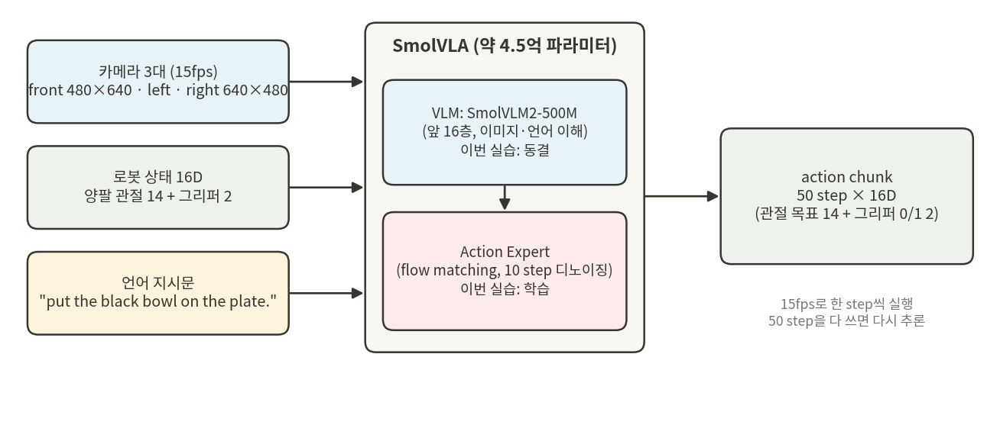
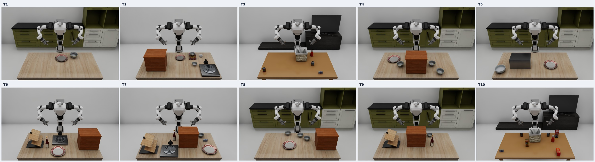

# RB-Y1 T1~T10에서 SmolVLA 학습 및 평가

---

# VLA와 SmolVLA란?

<https://huggingface.co/blog/smolvla>
<https://huggingface.co/lerobot/smolvla_base>
<https://github.com/huggingface/lerobot>

**VLA(Vision-Language-Action) 모델**은 카메라 영상(Vision)과 언어 지시문(Language)을 함께 보고 로봇 동작(Action)을 바로 출력하는 정책입니다. IL 실습의 BC 정책은 task 하나만 배웠지만, VLA는 지시문을 바꿔 가며 **모델 하나로 여러 task**를 수행합니다.

**SmolVLA**는 Hugging Face LeRobot 팀이 공개한 작은 VLA입니다(전체 4.5억 파라미터). 영상·언어를 이해하는 VLM(SmolVLM2-500M의 앞 16층)과, 그 정보를 받아 로봇 동작을 만드는 **action expert**로 이루어져 있습니다. action expert는 flow matching으로 한 번에 50 step 분량의 동작 묶음(**action chunk**)을 만듭니다. `lerobot/smolvla_base`는 커뮤니티 로봇 데이터로 미리 학습된 가중치이고, 이번 실습에서는 이것을 우리 RB-Y1 시뮬레이션 데이터로 **미세조정(fine-tuning)** 합니다.

이번 실습의 입력과 출력은 다음과 같습니다.



| 구분 | 내용 |
|---|---|
| 입력 영상 | `front`(머리 카메라 480×640), `left`·`right`(손목 카메라 640×480 세로) |
| 입력 상태 | 16차원: 오른팔 관절 7, 왼팔 관절 7, 오른손·왼손 그리퍼 열림 정도(0~1) |
| 입력 언어 | task의 지시문 (예: `put the black bowl on the plate.`) |
| 출력 | 16차원 action × 50 step. 팔은 다음 step의 절대 관절 목표(rad), 그리퍼는 열기 1 / 닫기 0 |

전체 흐름: **오라클로 시범 수집 → LeRobot 데이터셋 변환·검증 → SmolVLA 학습 → task마다 50회 평가**

---

<h1 id="base-env">기본 환경 설치</h1>

이 실습은 **각자 PC에서, 수업 시간 밖에** 진행합니다. 처음 한 번만 설치하면 됩니다. 이전 실습에서 만든 `lerobot-arena` 환경과 레포가 이미 있으면 이 절을 건너뛰고 [0️⃣ 환경 확인](#env-check)으로 가십시오.

**필요한 것**

| 항목 | 내용 |
|---|---|
| OS | Ubuntu 22.04 (조교 PC 기준. 다른 버전은 확인하지 못했습니다) |
| GPU | NVIDIA, VRAM 8GB 이상. `nvidia-smi`가 정상 동작해야 합니다(조교 PC 드라이버 580.178.04) |
| 디스크 | 여유 **250GB** 이상. 환경·캐시 약 45GB, 수집 raw 159GB, 데이터셋 7GB, 체크포인트·평가 약 7GB (조교 PC 측정) |
| 인터넷 | 환경 약 30GB, 모델 7.6GB를 내려받습니다 |

**걸리는 시간** (조교 PC, RTX 3090 기준)

| 단계 | 시간 |
|---|---|
| 기본 환경 설치 + 추가 설치 | 약 1시간 (대부분 다운로드) |
| 수집 | 혼자 순서대로 약 15시간 (task별 첫 시범 시간 × 50으로 추정) |
| 변환·병합 | 최대 약 8.5시간 (다른 작업과 동시에 돌리며 잰 값) |
| 학습 | 약 3시간 20분 (8GB GPU는 약 6~11.6시간으로 추정) |
| 평가 | 약 8~12시간 (추정) |

컴퓨터가 이틀 정도 쉬지 않고 돌아야 하므로 **일정을 미리 잡으십시오.** 명령은 대부분 시작해 두고 기다리면 됩니다.

조교가 아무것도 없는 빈 환경에서 아래 순서를 그대로 실행해, 수집부터 평가까지 동작하는 것을 확인했습니다.

**1. 레포 받기**

```bash
sudo apt install -y git curl
cd ~
git clone https://github.com/cailab-hy/lightwheel_rby1_transfer
git clone https://github.com/cailab-hy/rby1-sim-isaac
git clone https://github.com/cailab-hy/IsaacLab_RS.git
git -C ~/IsaacLab_RS checkout e83a5d2
git clone --branch v0.4.3 https://github.com/huggingface/lerobot.git
```

네 폴더 모두 **홈 폴더 바로 아래**에 두십시오. 스크립트가 `lightwheel_rby1_transfer`의 상위 폴더에서 나머지를 찾습니다. `detached HEAD` 안내는 정상입니다.

**2. conda 설치** (`conda`가 이미 있으면 건너뛰십시오)

```bash
curl -L -O https://github.com/conda-forge/miniforge/releases/latest/download/Miniforge3-Linux-x86_64.sh
bash Miniforge3-Linux-x86_64.sh -b -p ~/miniforge3
~/miniforge3/bin/conda init bash
```

**터미널을 닫고 새로 여십시오.**

**3. 환경 만들기** (약 30분)

```bash
conda create -y -n lerobot-arena python=3.11.16
conda activate lerobot-arena
conda install -y -c conda-forge ffmpeg=7.1.1 pinocchio=4.1.0
python -m pip install "setuptools==81.0.0"
python -m pip install --no-build-isolation --no-deps flatdict==4.0.1
cd ~
python -m pip install --no-deps -r lightwheel_rby1_transfer/vla_lab/requirements-lock.txt
python -m pip install --no-deps -e ~/lerobot \
    -e ~/IsaacLab_RS/source/isaaclab -e ~/IsaacLab_RS/source/isaaclab_assets \
    -e ~/IsaacLab_RS/source/isaaclab_mimic -e ~/IsaacLab_RS/source/isaaclab_rl \
    -e ~/IsaacLab_RS/source/isaaclab_tasks
```

- **순서를 바꾸지 마십시오.** `conda install pinocchio`는 NumPy 2.4.6을 함께 설치합니다. 다음의 lock 설치가 이것을 Isaac Sim이 요구하는 1.26.0으로 바꿉니다. 나중에 conda로 패키지를 더 설치하면 NumPy가 다시 바뀔 수 있습니다: [추가 설치 (4)](#install-numpy).
- `requirements-lock.txt`는 조교 환경의 패키지 버전을 그대로 고정한 목록입니다. `--no-deps`를 빼지 마십시오. 빼면 pip이 버전을 바꿉니다.
- `flatdict`를 먼저 설치하는 이유: lock 설치 중에 최신 setuptools로 빌드하면 `No module named 'pkg_resources'` 오류가 납니다.
- `pip check`에 나오는 버전 경고는 조교 환경의 버전을 그대로 고정해서 생기는 것입니다. 이 실습에서는 무시하십시오.

**4. Isaac Sim 라이선스 동의** (처음 한 번)

```bash
python -c "from isaacsim import SimulationApp"
```

`Do you accept the EULA? (Yes/No):`가 나오면 [라이선스](https://docs.omniverse.nvidia.com/platform/latest/common/NVIDIA_Omniverse_License_Agreement.html)를 확인하고 `Yes`를 입력하십시오. 동의하지 않으면 시뮬레이터가 시작되지 않습니다(`Unable to bootstrap inner kit kernel: EOF when reading a line`).

이제 [0️⃣ 환경 확인](#env-check)과 [추가 설치](#install)로 가십시오.

---

<h1 id="env-check">0️⃣ 환경 확인</h1>

**1. Course version이 고정되었는가?**

```bash
conda activate lerobot-arena
cd ~/lightwheel_rby1_transfer
git checkout main && git pull origin main
git -C ~/rby1-sim-isaac checkout main && git -C ~/rby1-sim-isaac pull origin main
./vla_lab/check_env.sh
```

조교 PC 출력:

```text
========== Python ==========
Python 3.11.16

========== PyTorch ==========
PyTorch: 2.7.0+cu128
CUDA: 12.8
GPU: NVIDIA GeForce RTX 3090

========== Isaac Sim ==========
isaacsim: 5.1.0.0
isaacsim-core: 5.1.0.0
isaacsim-app: 5.1.0.0

========== IsaacLab ==========
Path: /home/cai/IsaacLab_RS
VERSION: 2.3.0
e83a5d2 Update play_one_episode.py

========== LeRobot ==========
LeRobot: 0.4.3
Path: /home/cai/lerobot/src/lerobot/__init__.py

========== Repositories ==========
lightwheel_rby1_transfer: <commit> (main)
rby1-sim-isaac: 146bec3 (main)
Robot self-collision layer: OK

========== SmolVLA weights (HF cache) ==========
lerobot/smolvla_base: OK
HuggingFaceTB/SmolVLM2-500M-Video-Instruct: OK

========== GPU / driver ==========
NVIDIA GeForce RTX 3090, 580.178.04, 24576 MiB
```

- GPU 이름과 메모리, 경로의 `/home/cai`는 PC마다 다릅니다. 나머지 버전이 같으면 됩니다.
- `<commit>` 자리에는 `main` 브랜치의 commit 해시(7자리)가 나옵니다. `rby1-sim-isaac`도 `main`이며, 이후 commit이 생기면 해시는 `146bec3`과 다를 수 있습니다.
- `Robot self-collision layer: MISSING`이면 로봇 레포가 자기충돌 asset(`146bec3`)이 들어가기 전 버전입니다. 이 실습의 데이터와 평가는 로봇 링크끼리 충돌하는 asset을 씁니다: `git -C ~/rby1-sim-isaac pull origin main`.
- `SmolVLA weights`가 `MISSING`이면 아래 **추가 설치**를 먼저 하십시오.
- `VERSION: MISSING`이면 `IsaacLab_RS` 경로가 틀린 것입니다: [추가 설치 (2)](#install-paths).
- 마지막 줄에 GPU 대신 `Failed to initialize NVML`이 나오면 [추가 설치 (3)](#install-gpu)을 먼저 하십시오.

**2. 경로 설정 확인**

```bash
conda activate lerobot-arena
cd ~/lightwheel_rby1_transfer
./run_python.sh scripts/project_paths.py
```

`RBY_USD`, `LIGHTWHEEL_CACHE`가 실제 있는 경로로 나오면 됩니다. 레포 위치가 다르면 README의 `RBY1_*` 환경변수를 설정합니다.

> **이 명령을 통과해도 설치가 끝난 것은 아닙니다.** Lightwheel 캐시 폴더가 비어 있어도 통과하고, `IsaacLab_RS` 경로는 검사하지 않습니다. 새 PC에서는 [추가 설치의 (1) 설치 점검](#install-check)을 반드시 실행하십시오.

<h1 id="install">추가 설치</h1>

기본 환경 다음에 필요한 Asset과 모델을 받고, 설치 상태를 확인합니다. (2)~(5)에는 다른 PC(RTX 5000 Ada Laptop)에서 실제로 난 오류와 해결 방법을 적었습니다. **(1)이 모두 `OK`이면 그 항목들은 건너뛰어도 됩니다.**

<h2 id="install-check">(1) 설치 점검</h2>

패키지, 경로, 드라이버, Asset, 모델, 디스크를 한 번에 확인합니다. 시뮬레이터를 띄우지 않으므로 몇 초면 끝납니다. **처음에는 `Lightwheel USD`와 모델이 `FAIL`인 것이 정상입니다.** `FAIL` 줄 끝에 볼 곳이 나옵니다. 조치를 할 때마다 다시 실행하십시오.

```bash
conda activate lerobot-arena
cd ~/lightwheel_rby1_transfer
./vla_lab/check_install.sh
```

모두 끝나면 다음과 같이 나옵니다(사용자 이름이 `student`인 예).

```text
[OK] python 3.11  3.11.16
[OK] isaacsim==5.1.0.0  5.1.0.0
[OK] torch==2.7.0+cu128  2.7.0+cu128
[OK] lerobot==0.4.3  0.4.3
[OK] lightwheel_sdk==1.0.1  1.0.1
[OK] pinocchio  4.1.0
[OK] IsaacLab_RS  /home/student/IsaacLab_RS
[OK] rby1-sim-isaac  /home/student/rby1-sim-isaac
[OK] nvidia-smi  NVIDIA GeForce RTX 3090, 580.178.04
[OK] numpy==1.26.0  1.26.0  /home/student/miniforge3/envs/lerobot-arena/lib/python3.11/site-packages/numpy/__init__.py
[OK] scipy==1.15.3  1.15.3  /home/student/miniforge3/envs/lerobot-arena/lib/python3.11/site-packages/scipy/__init__.py
[OK] Lightwheel USD 16/16  /home/student/.cache/lightwheel_sdk
[OK] lerobot/smolvla_base
[OK] HuggingFaceTB/SmolVLM2-500M-Video-Instruct
[OK] 디스크 200GB  여유 421GB, 수집한 데이터 0GB

모두 OK입니다.
```

이 점검은 파일과 버전만 봅니다. 실제 동작은 마지막 [(7) 시험 수집](#install-smoke)으로 확인합니다.

<h2 id="install-paths">(2) 폴더 경로</h2>

**오류 메시지**

```text
FileNotFoundError: [Errno 2] No such file or directory: '/home/cai/lw_benchhub/IsaacLab_RS/VERSION'
```

**원인**: `IsaacLab_RS`, `rby1-sim-isaac`, `lerobot`은 **`lightwheel_rby1_transfer`의 상위 폴더**에서 찾습니다(`scripts/project_paths.py`). 위 PC에서는 `IsaacLab_RS`가 `~`에 있는데 찾는 위치는 `~/lw_benchhub`였습니다. 다음 구성이면 환경변수가 필요 없습니다. 사용자 이름은 달라도 됩니다.

```text
~/
├── lightwheel_rby1_transfer/
├── IsaacLab_RS/
├── rby1-sim-isaac/
└── lerobot/
```

**해결**: 코드를 고치거나 다시 clone하지 말고, 실제 위치를 환경변수로 알려 줍니다. `export`만 하면 새 터미널이나 재부팅 후 사라지므로 `~/.bashrc`에 넣습니다.

```bash
echo 'export RBY1_ISAACLAB_ROOT="$HOME/IsaacLab_RS"' >> ~/.bashrc
source ~/.bashrc
conda activate lerobot-arena
cat "$RBY1_ISAACLAB_ROOT/VERSION"    # 2.3.0
```

- `rby1-sim-isaac`도 `FAIL`이면 같은 방법으로 `RBY1_SIM_ROOT`를 지정합니다.
- 사용자 이름이 `cai`가 아니면 `git status`에 `.assets/lightwheel`, `.assets/rby1`이 수정됨(`M`)으로 나옵니다. 실행할 때 각 PC의 경로로 자동 연결되기 때문이며 정상입니다. 조교가 이 상태에서 `git checkout main`과 `git pull`이 되는 것을 확인했습니다. 이 두 줄은 commit하지 마십시오.

<h2 id="install-gpu">(3) NVIDIA 드라이버</h2>

**오류 메시지**

```text
Failed to initialize NVML: Driver/library version mismatch
NVML library version: 580.178

[omni.physx.plugin] CUDA libs are present, but no suitable CUDA GPU was found!
```

**원인**: 메모리에 올라온 드라이버 커널 모듈과 NVML 라이브러리의 버전이 다릅니다. 보통 드라이버가 업데이트된 뒤 재부팅하지 않았을 때 생깁니다. 이때 **PyTorch에서는 GPU가 인식되는데 Isaac Sim의 PhysX에서만 실패**할 수 있으므로, `torch.cuda.is_available()`로 판단하지 말고 `nvidia-smi`로 확인하십시오.

**해결**: 실행 중인 작업을 끝내고 재부팅합니다.

```bash
sudo reboot
```

재부팅 후 `nvidia-smi`가 오류 없이 GPU와 드라이버 버전을 보여 주면 됩니다. 위 PC에서는 드라이버 580.178.04, CUDA 13.0으로 복구되었고, 이후 Isaac Sim 로그에서 Warp가 CUDA GPU를 정상 인식했습니다.

<h2 id="install-numpy">(4) NumPy·SciPy</h2>

**오류 메시지** (셋 중 하나 이상)

```text
ImportError: cannot import name '_spropack' from 'scipy.sparse.linalg._propack'

AttributeError: module 'numpy._globals' has no attribute '_signature_descriptor'

TypeError: Unable to write from unknown dtype, kind=f, size=0    # omni.syntheticdata, SyntheticData.py
```

**원인**: 환경 안의 NumPy·SciPy 파일이 서로 맞지 않거나 손상된 상태입니다. 위 PC에서는 `numpy-2.4.6.dist-info`와 이전 설치의 잔여 폴더가 발견되었습니다. `conda install pinocchio`가 바로 이 NumPy 2.4.6을 함께 설치하므로, 설치 순서가 원인이었을 가능성이 높습니다([기본 환경 설치](#base-env) 3번). Isaac Sim 5.1은 `numpy==1.26.0`, `scipy==1.15.3`을 요구합니다(`isaacsim-kernel`, `isaacsim-core`의 의존성).

`TypeError`의 직접 원인은 확정되지 않았습니다. NumPy·SciPy를 정리한 뒤 오라클을 다시 실행했을 때 같은 오류가 재발하지 않아 여기에 함께 적었습니다.

**해결**

**1단계.** 현재 상태를 확인하고 pip으로 제거합니다. 조교 PC의 `conda list`에는 두 패키지 모두 채널이 `pypi`로 나옵니다.

```bash
conda activate lerobot-arena
conda list numpy
conda list scipy
python -m pip uninstall -y numpy scipy
```

**2단계.** 제거되지 않고 남은 폴더를 찾습니다. **아무것도 출력되지 않으면 3단계로 넘어가십시오.**

```bash
SITE="$CONDA_PREFIX/lib/python3.11/site-packages"
find "$SITE" -maxdepth 1 \( -name numpy -o -name 'numpy-*.dist-info' -o -name numpy.libs \
    -o -name scipy -o -name 'scipy-*.dist-info' -o -name scipy.libs \) -print
```

출력이 있으면 삭제하지 말고 백업 폴더로 옮깁니다. 위 `find`와 같은 대상을 옮기는 명령입니다.

```bash
BACKUP="$HOME/numpy_scipy_backup_$(date +%Y%m%d_%H%M%S)"
mkdir -p "$BACKUP"
find "$SITE" -maxdepth 1 \( -name numpy -o -name 'numpy-*.dist-info' -o -name numpy.libs \
    -o -name scipy -o -name 'scipy-*.dist-info' -o -name scipy.libs \) -exec mv -t "$BACKUP" {} +
```

**3단계.** 지정한 버전으로 다시 설치합니다. `--no-deps`는 다른 패키지를 건드리지 않게 하고, `--no-cache-dir`은 손상된 캐시를 쓰지 않게 합니다.

```bash
python -m pip install --no-cache-dir --no-deps "numpy==1.26.0" "scipy==1.15.3"
```

**4단계.** (1) 설치 점검을 다시 실행합니다. 경로가 `envs/lerobot-arena` 아래가 아니면 다른 위치(예: `~/.local`)의 패키지를 읽고 있는 것입니다.

- 이후 다른 패키지를 `pip install`하면 NumPy가 다시 바뀔 수 있습니다. 설치한 뒤에는 (1)을 다시 실행하십시오.

<h2 id="install-assets">(5) Lightwheel USD Asset</h2>

**오류 메시지**

```text
FileNotFoundError: Missing external asset directory: /home/cai/.cache/lightwheel_sdk. See README.md (실행 환경과 경로 설정)

Could not open asset: .assets/lightwheel/floorplan/robocasa-libero-1-1/scene.usd
Could not open asset: .assets/lightwheel/object/Plate012/Plate012.usd
Could not open asset: .assets/lightwheel/object/Bowl008/Bowl008.usd

Lightwheel USD 2/16개 없음: floorplan/robocasa-libero-8-8/scene.usd, object/Bowl009/Bowl009.usd
```

**원인**: 장면과 물체 USD는 레포에 들어 있지 않고 Lightwheel 서버에서 `~/.cache/lightwheel_sdk`로 받아야 합니다. `lw_benchhub`의 `git clone`, `git lfs pull`, `pip install -e .`은 이 파일을 받지 않습니다.

> **주의**: `import lightwheel_sdk.loader`는 빈 폴더 3개(16K)만 만듭니다. 그러면 첫 번째 오류는 사라지지만 곧바로 `Could not open asset`이 납니다. 빈 폴더를 직접 만들거나 USD 파일 이름을 바꾸는 것으로도 해결되지 않습니다.

**해결**: 아래 명령으로 T1~T10에 필요한 16개(장면 3, 물체 13)를 **조교 PC와 같은 버전으로** 받습니다. Lightwheel 로그인은 필요 없습니다.

```bash
conda activate lerobot-arena
cd ~/lightwheel_rby1_transfer
./vla_lab/fetch_assets.sh
```

출력(SDK 로그 줄 생략).

```text
OK 1-1 /home/student/.cache/lightwheel_sdk/floorplan/robocasa-libero-1-1/scene.usd
OK 2-2 /home/student/.cache/lightwheel_sdk/floorplan/robocasa-libero-2-2/scene.usd
OK 8-8 /home/student/.cache/lightwheel_sdk/floorplan/robocasa-libero-8-8/scene.usd
OK AlphabetSoup001 /home/student/.cache/lightwheel_sdk/object/AlphabetSoup001/AlphabetSoup001.usd
...
OK Plate012 /home/student/.cache/lightwheel_sdk/object/Plate012/Plate012.usd
```

- 조교가 빈 캐시에서 실행해 확인했습니다. 로그인 없이 약 1분 걸렸고 캐시는 합계 209MB였습니다(네트워크에 따라 다름). 끊기면 같은 명령을 다시 실행하십시오.
- 이 스크립트는 버전 ID로 고정해 받습니다. 직접 SDK를 호출하면서 **버전 ID를 빼지 마십시오.** ID 없이 받으면 그 시점의 최신 버전을 받습니다. 캐시와 버전이 다르면 이미 있던 장면 폴더를 지우고 교체하므로 조교 결과와 다른 장면이 될 수 있습니다.
- SDK는 항상 `~/.cache/lightwheel_sdk`에 저장합니다. 다른 위치(`RBY1_LIGHTWHEEL_CACHE`)를 쓰려면 받은 뒤 폴더 구조를 유지한 채 옮기십시오.
- 이 실습의 수집·평가 스크립트는 `lw_benchhub`를 import하지 않습니다. 조교 PC에서 `~/lw_benchhub` 폴더가 없는 상태로 오라클 수집이 정상 동작하는 것을 확인했습니다.
- 조교가 이렇게 받은 Asset으로 T1~T10을 seed 0에서 다시 수집해 기존 데이터와 비교했습니다. 10개 task 모두 길이, 초기 배치, 관절 상태, action이 같았습니다(최대 차이 0). 아무것도 없는 격리 환경에 [기본 환경](#base-env)부터 새로 설치해 수집한 T1·T6 seed 0~1도 같았습니다.

<h2 id="install-weights">(6) SmolVLA 가중치</h2>

환경 확인에서 `SmolVLA weights: MISSING`이 나오면 모델만 내려받습니다(로그인 불필요, 처음 한 번).

```bash
conda activate lerobot-arena
hf download lerobot/smolvla_base
hf download HuggingFaceTB/SmolVLM2-500M-Video-Instruct
```

- 조교가 빈 캐시(`HF_HOME`을 새 폴더로 지정)에서 위 두 명령을 실행해 확인했습니다. huggingface_hub 0.36.2 기준 `smolvla_base`는 약 1분, SmolVLM2는 9분 이상 걸렸고 캐시는 합계 7.6GB였습니다(네트워크에 따라 다름).
- 학습·평가 스크립트는 `HF_HUB_OFFLINE=1`로 실행되므로, 모델이 캐시에 없으면 다운로드하지 않고 에러를 냅니다.

<h2 id="install-smoke">(7) 시험 수집</h2>

마지막으로 T1 시범 1개를 실제 시뮬레이터에서 수집합니다. 본 데이터와 섞이지 않게 별도 폴더에 저장합니다.

```bash
conda activate lerobot-arena
cd ~/lightwheel_rby1_transfer
./vla_lab/collect_oracle.sh --task T1 --num-demos 1 --seed-start 0 --output ~/datasets/vla_lab/_smoke/T1/oracle
```

```text
[T1] attempt 1 seed 0: SAVED (258 frames, 67.0 s) | saved 1/1
SUMMARY {"task": "T1", "attempts": 1, "saved": 1, "oracle_success_rate": 1.0, "seeds": [0, 0], "failures_by_stage": {}, "mean_seconds_saved": 17.2, ...}
```

`SAVED`와 `"saved": 1`이 나오면 설치가 끝난 것입니다. `EOF when reading a line`이 나오면 [기본 환경 설치](#base-env) 4번의 라이선스 동의를 먼저 하십시오. [2️⃣ 오라클 데이터 수집](#oracle)으로 가십시오.

- 조교 PC(RTX 3090)에서 Isaac Sim 시작을 포함해 약 1.5분 걸렸습니다. 처음 실행하는 PC는 셰이더를 만드느라 약 5분 더 걸립니다.
- 조교 PC와 새로 설치한 격리 환경에서 seed 0은 모두 `258 frames`였습니다. GPU가 다른 PC에서도 같은 값이 나오는지는 확인하지 못했으므로, 값이 달라도 `SAVED`이면 설치 문제는 아닙니다.
- 다시 시험할 때는 `~/datasets/vla_lab/_smoke`를 지우거나 `--output`을 바꾸십시오. 같은 폴더면 이미 1개가 저장된 것으로 보고 새로 수집하지 않은 채 끝납니다(`Resuming: 1 attempts, 1 saved`).

---

# 1️⃣ Task 소개

10개 task를 **모델 하나**로 학습합니다. 모델은 지시문을 보고 어떤 task인지 구분합니다.



| Task | 지시문 (모델 입력) | 작업 | 역할 |
|---|---|---|---|
| T1 | `put the black bowl on the plate.` | 검은 그릇을 접시에 놓기 | Basic Pick-and-Place |
| T2 | `Pick the akita black bowl on the cookies box and place it on the plate.` | 쿠키 상자 위의 그릇을 접시에 놓기 | Spatial Relational Pick-and-Place |
| T3 | `Pick up the ketchup, and put it in the basket.` | 케첩을 바구니에 넣기 | Object-Variation Pick-and-Place |
| T4 | `Open the top drawer of the cabinet.` | 수납장 위 서랍 열기 | Single-Step Articulated Manipulation |
| T5 | `Open the microwave.` | 전자레인지 문 열기 | Articulated Appliance Manipulation |
| T6 | `Turn on the stove.` | 스토브 켜기 | Contact / Actuation |
| T7 | `Open the top layer of the drawer and put the bowl inside.` | 위 서랍을 열고 그릇 넣기 | Compositional Manipulation |
| T8 | `Stack the black bowl in the middle on the black bowl at the back.` | 가운데 그릇을 뒤쪽 그릇 위에 쌓기 | Precision Stacking |
| T9 | `Put the black bowl in the bottom drawer of the cabinet and close it.` | 그릇을 아래 서랍에 넣고 닫기 | Long-Horizon Sequential Manipulation |
| T10 | `Pick up the alphabet soup and the tomato sauce, and put them in the basket.` | 알파벳 수프와 토마토 소스를 바구니에 넣기 | Multi-Object Sequential Manipulation |

- 물체 위치와 방향은 에피소드마다 `environments/Txx.json`의 `randomization` 범위 안에서 바뀝니다. 같은 seed는 항상 같은 배치입니다.
- 성공 판정은 레포의 `success_original`(LW-BenchHub 원본 판정)입니다. 조건을 만족한 뒤 약 3.5초(52 step)가 지나야 성공으로 확정됩니다. 대부분의 task는 **그리퍼가 물체에서 멀어져야** 성공입니다.

---

<h1 id="oracle">2️⃣ 오라클 데이터 수집</h1>

사람이 키보드로 500개 시범을 모으기는 어렵습니다. 그래서 시뮬레이터의 **정답 상태**(물체·손잡이·서랍의 실제 위치)를 읽어 움직이는 스크립트, 즉 **오라클(oracle)**로 시범을 모읍니다.

## (1) 동작 원리

- 시범 하나 = 하위 동작의 고정된 순서입니다. 예: T1은 `접근 → 파지 전 자세 → 파지 → 들기 → 운반 → 놓기 → 놓은 뒤 위로 → 준비 자세로 복귀`.
- 각 하위 동작을 시작할 때 정답 상태로 목표 위치를 계산하고, 그리퍼 끝(TCP)을 부드러운 직선 경로로 움직입니다.
- 제어 경로는 키보드/VR 수집기와 같습니다: **Differential IK(DLS) → 18개 관절 절대 목표**, 관절 속도 제한 0.8 rad/s, 15fps(물리 1/105초 × 7).
- 기록 형식도 키보드 수집기와 같은 raw 형식(`<output>_raw/episode-*/`)입니다. 그래서 기존 `export_dataset.sh`, `--validate`, `replay_dataset.sh`가 그대로 동작합니다.
- **복구 동작은 없습니다.** 재파지, 노이즈, 재시도를 하지 않습니다. 첫 시도가 실패한 seed는 저장하지 않고 다음 seed로 넘어갑니다(실패 수와 원인만 기록).
- 오라클 자체에는 무작위성이 없습니다. 물체 배치만 seed(`numpy.random.default_rng(seed)`)로 정해집니다.
- 로봇은 자기 몸과 충돌합니다(팔·몸통·머리·손바닥이 convex hull 충돌체). 수집기는 PhysX 접촉 보고로 로봇 링크끼리 닿았는지 매 step 확인하고, 닿은 시범은 성공해도 저장하지 않습니다(실패 원인 `self_contact`, 한 손의 두 손가락끼리 닿는 것은 허용).
- 성공 판정 후 저장 직전에 원래 조건이 아직 성립하는지 한 번 더 확인합니다. `success_original`은 조건이 한 번 성립하면 3.5초 뒤 확정되므로, 그사이 물체가 미끄러져 조건이 깨진 시범도 성공으로 남을 수 있기 때문입니다(실패 원인 `latched_then_undone`).

| Task | 사용하는 팔 | 하위 동작 |
|---|---|---|
| T1 | 왼팔 | 손을 수직으로 세워 그릇의 로봇 쪽 테두리 집기 → 들기 → 접시 위로 운반 → 놓기 → 위로 → 준비 자세 |
| T2 | 왼팔 | T1과 같음 (쿠키 상자 위 그릇, 더 얕게 집기) |
| T3 | 왼팔 | 케첩 위에서 수직으로 집기 → 바구니 테두리 위로 들기 → 테두리 바로 위에서 놓아 떨어뜨리기 → 준비 자세 |
| T4 | 왼팔 | 손잡이에 접근 → 손가락 하나를 손잡이 뒤 틈에 걸어 잡기 → 14cm 당기기 → 놓고 위·뒤로 → 준비 자세 |
| T5 | 오른팔 | 손잡이(세로 막대) 잡고 약 10° 당기기 → 놓고 손잡이에서 빠지기 → 손가락을 모아 문 안쪽 끝 뒤에 넣기 → 원호를 따라 밀어 열기 → 위로 → 준비 자세 |
| T6 | 왼팔 | 손잡이 능선을 위에서 집기 → 수직축으로 0.9 rad 돌리기 → 놓고 위로 → 준비 자세 |
| T7 | 왼팔 | 위 서랍 끝까지 당기기 → 그릇 테두리 집기 → 높이 들어 서랍 위로 → 서랍 앞쪽에 놓기 → 서랍에서 떨어진 자세 |
| T8 | 왼팔 | 손을 수직으로 세워 가운데 그릇 테두리 집기 → 뒤쪽 그릇 위로 운반 → 놓기 → 준비 자세 |
| T9 | 왼팔 | 그릇을 열린 아래 서랍에 넣기 → 손끝으로 손잡이를 밀어 닫기(2단계) → 준비 자세 |
| T10 | 왼팔 → 오른팔 | 수프(왼팔)를 바구니에 넣고 복귀 → 토마토 소스(오른팔)를 바구니에 넣고 복귀 (복귀: 수직 손 그대로 제자리 위로 → 관절 공간 직선으로 준비 자세) |

## (2) 수집 명령어

conda 환경 활성화

```bash
conda activate lerobot-arena
```

task 하나 수집 (T1, 성공 시범 50개, seed 0부터)

```bash
cd ~/lightwheel_rby1_transfer
./vla_lab/collect_oracle.sh --task T1 --num-demos 50 --seed-start 0
```

T1~T10 전부 순서대로 수집

```bash
cd ~/lightwheel_rby1_transfer
for T in T1 T2 T3 T4 T5 T6 T7 T8 T9 T10; do
    ./vla_lab/collect_oracle.sh --task $T --num-demos 50 --seed-start 0
done
```

| 인자 | 기본값 | 설명 |
|---|---|---|
| `--task` | (필수) | T1~T10 |
| `--num-demos` | 50 | 저장할 **성공** 시범 수 |
| `--seed-start` | 0 | 첫 시도의 배치 seed. 시도 k는 seed `seed-start + k` |
| `--max-attempts` | 3 × num-demos | 같은 폴더의 이전 시도까지 합쳐 이 횟수가 되면 멈춤 |
| `--output` | `~/datasets/vla_lab/<task>/oracle` | LeRobot 데이터셋 폴더. raw는 `<output>_raw` |
| `--joint-speed` | 0.8 | 관절 속도 제한(rad/s), 수집기 기본값과 같음 |
| `--video` | 없음 | 첫 성공 시범을 정면 카메라 mp4로 저장 |

- 학습 seed는 0~9999 범위만 씁니다. 평가 seed는 100000번대라 겹치지 않습니다.
- 수집이 중간에 끊기면 같은 명령을 다시 실행하십시오. `<output>_raw/oracle_attempts.jsonl`을 읽고 마지막 seed 다음부터 이어서 수집합니다.
- `--max-attempts`는 이번 실행의 추가 횟수가 아닙니다. 이미 그 횟수만큼 시도한 폴더에서 같은 값으로 다시 실행하면 새로 수집하지 않고 끝납니다. 더 시도하려면 값을 늘리십시오.

## (3) 출력 예시

```text
[T9] attempt 1 seed 0: SAVED (496 frames, 406.6 s) | saved 1/50
[T9] attempt 2 seed 1: SAVED (512 frames, 425.4 s) | saved 2/50
...
[T9] attempt 33 seed 32: FAILED at hold (750 frames, 654.0 s) | saved 32/50
...
[T9] attempt 50 seed 49: SAVED (504 frames, 335.8 s) | saved 49/50
SUMMARY {"task": "T9", "attempts": 51, "saved": 50, "oracle_success_rate": 0.9804, "seeds": [0, 50], "failures_by_stage": {"hold": 1}, "mean_seconds_saved": 33.8, ...}
```

- `<output>_raw/oracle_attempts.jsonl`: 시도마다 seed, 저장 여부, 길이, 실패한 하위 동작, 로봇 링크끼리 닿은 접촉(`self_contacts`), 팔·손바닥이 장면에 닿은 접촉(`scene_contacts`).
- 로봇 링크끼리 닿은 시도는 `FAILED at self_contact ... | self contact [...]`로 표시됩니다.
- `<output>_raw/oracle_summary.json`: 시도 수, 성공 수, 오라클 성공률, 실패 원인별 횟수.

## (4) 오라클 결과 (조교 PC)

| Task | 시도 | 저장 | 오라클 성공률 | 실패 원인 | 평균 길이(초) | 수집 시간(분) | 최대 VRAM |
|---|---|---|---|---|---|---|---|
| T1 | 51 | 50 | 98.0% | 시간 초과(하위 동작 실패) 1 | 17.53 | 53.8 | 3.12 GB |
| T2 | 50 | 50 | 100.0% | - | 16.95 | 54.6 | 3.25 GB |
| T3 | 55 | 50 | 90.9% | 시간 초과(하위 동작 실패) 5 | 22.70 | 94.9 | 3.12 GB |
| T4 | 50 | 50 | 100.0% | - | 17.20 | 29.0 | 3.12 GB |
| T5 | 50 | 50 | 100.0% | - | 27.07 | 246.3 | 3.16 GB |
| T6 | 50 | 50 | 100.0% | - | 14.27 | 39.8 | 3.27 GB |
| T7 | 50 | 50 | 100.0% | - | 41.27 | 114.5 | 3.29 GB |
| T8 | 51 | 50 | 98.0% | 확정 후 조건 깨짐 1 | 18.83 | 61.6 | 3.12 GB |
| T9 | 51 | 50 | 98.0% | 시간 초과(하위 동작 실패) 1 | 33.80 | 340.2 | 3.28 GB |
| T10 | 51 | 50 | 98.0% | 시간 초과(하위 동작 실패) 1 | 41.46 | 122.5 | 3.34 GB |
| 합계 | 509 | 500 | 98.2% | | | | |

- **로봇 링크끼리 닿은 시도는 509번 중 0번**입니다(실패 원인 `self_contact` 없음). `self_collision_check.py`로 저장된 시범 500개를 다시 계산해도 링크끼리 겹친 step이 없습니다.
- 수집 시간은 조교 PC(RTX 3090, i5-8500 6코어)에서 **task 3개를 동시에 수집하면서 변환(`export_dataset.sh`)도 1~2개 함께 돌린** 값입니다(CPU가 병목). 마지막에 남은 T5·T9는 다른 작업이 가장 많을 때 돌아 특히 오래 걸렸습니다. 혼자 돌리면 훨씬 짧습니다.
- 최대 VRAM은 `vram_monitor.py`로 잰 수집 프로세스 하나의 값입니다(MiB ÷ 1024). 모든 task가 3.4GB 이하입니다.
- T3 실패 5회는 모두 제한 시간까지 성공 조건이 성립하지 않은 경우(`hold`)입니다. 이 중 3회는 손목의 D405 카메라 마운트가 파지 직전에 바구니 테두리를 오래 누른 경우입니다. 저장된 시범 4개에도 마운트가 테두리에 잠깐(3~7 step) 닿는 장면이 있습니다(물리적으로 막히는 접촉이며 관통은 아님).
- 같은 seed는 항상 같은 결과입니다. 새 폴더에 다시 clone해 T1·T9를 수집했을 때 seed별 성공 여부, 길이, 초기 배치, 기록된 관절 값이 모두 처음 수집과 같았습니다(최대 차이 0).

각 task의 첫 번째 저장 시범을 `replay_dataset.sh --mode action --video`로 정면 카메라에서 녹화한 영상입니다.

[▶ T1 오라클 시범](assets/oracle/oracle_T1.mp4)

[▶ T2 오라클 시범](assets/oracle/oracle_T2.mp4)

[▶ T3 오라클 시범](assets/oracle/oracle_T3.mp4)

[▶ T4 오라클 시범](assets/oracle/oracle_T4.mp4)

[▶ T5 오라클 시범](assets/oracle/oracle_T5.mp4)

[▶ T6 오라클 시범](assets/oracle/oracle_T6.mp4)

[▶ T7 오라클 시범](assets/oracle/oracle_T7.mp4)

[▶ T8 오라클 시범](assets/oracle/oracle_T8.mp4)

[▶ T9 오라클 시범](assets/oracle/oracle_T9.mp4)

[▶ T10 오라클 시범](assets/oracle/oracle_T10.mp4)


---

# 3️⃣ 변환·검증·재생

수집기는 raw 기록만 저장합니다. 학습에 쓰려면 레포의 기존 도구로 **LeRobot v3 데이터셋**으로 바꾸고, 원본과 일치하는지 검증합니다. 변환 형식은 실제 RB-Y1 데이터셋과 같은 `rby1` 형식입니다(15fps, state/action 16차원, 카메라 3대 AV1 영상).

## (1) task별 변환 + 검증

```bash
conda activate lerobot-arena
cd ~/lightwheel_rby1_transfer
for T in T1 T2 T3 T4 T5 T6 T7 T8 T9 T10; do
    ./export_dataset.sh --output ~/datasets/vla_lab/$T/oracle --format rby1 --validate
done
```

- `--validate`는 LeRobot 로딩, raw 기록과 숫자 완전 일치, 영상 프레임 수, 성공 판정 재계산을 확인합니다. 마지막에 다음과 같이 나오면 됩니다(T1 예시).

```text
{
  "episodes": 50,
  "frames": 13145,
  "fps": 15,
  "format": "rby1",
  "numeric_arrays_exact_to_raw": true,
  "all_video_frame_counts_match": true,
  "max_raw_to_video_mse": 11.213232421875
}
```

- 변환 시간: task당 32~86분(시범 50개, 합계 약 8.4시간). 조교 PC에서 수집 3개와 변환 1~2개를 동시에 돌리며 잰 값입니다. 긴 시범이 많은 T7·T9·T10이 오래 걸립니다.
- 검증 결과는 `~/datasets/vla_lab/<task>/validation.json`에 저장됩니다.

## (2) 10개 task를 데이터셋 하나로 합치기

SmolVLA를 **모델 하나**로 학습하려면 10개 데이터셋을 하나로 합칩니다. 에피소드마다 원래 지시문이 그대로 task 문자열로 남고, 스크립트가 `selected_tasks.csv`의 지시문과 같은지 확인합니다.

```bash
conda activate lerobot-arena
cd ~/lightwheel_rby1_transfer
./run_python.sh vla_lab/scripts/merge_datasets.py \
    --inputs ~/datasets/vla_lab/T{1,2,3,4,5,6,7,8,9,10}/oracle \
    --output ~/datasets/vla_lab/merged/RBY1-T1-T10-Oracle
```

```text
~/datasets/vla_lab/T1/oracle: 50 episodes, task ['T1']
~/datasets/vla_lab/T2/oracle: 50 episodes, task ['T2']
~/datasets/vla_lab/T3/oracle: 50 episodes, task ['T3']
~/datasets/vla_lab/T4/oracle: 50 episodes, task ['T4']
~/datasets/vla_lab/T5/oracle: 50 episodes, task ['T5']
~/datasets/vla_lab/T6/oracle: 50 episodes, task ['T6']
~/datasets/vla_lab/T7/oracle: 50 episodes, task ['T7']
~/datasets/vla_lab/T8/oracle: 50 episodes, task ['T8']
~/datasets/vla_lab/T9/oracle: 50 episodes, task ['T9']
~/datasets/vla_lab/T10/oracle: 50 episodes, task ['T10']
MERGED ~/datasets/vla_lab/merged/RBY1-T1-T10-Oracle: 500 episodes, 188315 frames, 10 tasks
(소요 약 10분)
```

## (3) 데이터 요약

IL 실습의 `summarize_demos.py`처럼 task별로 시범 길이와 그리퍼 사용을 확인합니다.

```bash
conda activate lerobot-arena
cd ~/lightwheel_rby1_transfer
./run_python.sh vla_lab/scripts/summarize_dataset.py --root ~/datasets/vla_lab/merged/RBY1-T1-T10-Oracle
```

```text
task   eps  len mean   min   max  sec mean    min    max  switch   idle
T1      50     262.9   253   271      17.5   16.9   18.1     2.0  15.7%
T2      50     254.3   249   264      17.0   16.6   17.6     2.0  27.2%
T3      50     340.6   322   380      22.7   21.5   25.3     2.0  10.0%
T4      50     258.0   258   258      17.2   17.2   17.2     2.0  22.2%
T5      50     406.0   406   406      27.1   27.1   27.1     3.0   9.1%
T6      50     214.0   214   214      14.3   14.3   14.3     2.0  27.2%
T7      50     619.1   611   627      41.3   40.7   41.8     4.0   9.4%
T8      50     282.5   276   297      18.8   18.4   19.8     2.0  12.1%
T9      50     507.0   495   522      33.8   33.0   34.8     3.0   8.6%
T10     50     621.9   608   648      41.5   40.5   43.2     4.0  11.1%
total: 500 episodes, 188315 steps (209.2 min)
```

- `len` — 시범 길이(step 수). `sec`는 15fps 기준 초(len / 15).
- `switch` — 그리퍼 열기/닫기 전환 횟수(두 손 합).
- `idle` — 팔 관절 목표가 모든 관절에서 0.001 rad 미만으로 바뀐 step의 비율. 파지·놓기 대기와, 마지막에 성공 판정이 확정되기까지 기다리는 약 3.5초가 포함됩니다.

## (4) 재생으로 확인

변환한 시범을 시뮬레이터에서 다시 실행해 성공이 재현되는지 봅니다. `--mode action`은 기록된 관절 목표를 수집 때와 같은 물리 step으로 다시 실행합니다.

```bash
conda activate lerobot-arena
cd ~/lightwheel_rby1_transfer
./replay_dataset.sh --root ~/datasets/vla_lab/T1/oracle --episode 0,1 --mode action --headless --video ~/vla_lab_runs/replay/
```

```text
REPLAY episode 0: task T1, 258 frames at 15 fps, mode action
VIDEO ~/vla_lab_runs/replay/T1_episode_0_action.mp4 (288 frames, 19.2 s)
RESULT {"episode": "episode 0", "frames": 258, "recorded_success": true, "replayed_success_original": true, "max_joint_drift_rad": 0.0033, "final_joint_drift_rad": 0.0, ...}
REPLAY episode 1: task T1, 267 frames at 15 fps, mode action
VIDEO ~/vla_lab_runs/replay/T1_episode_1_action.mp4 (297 frames, 19.8 s)
RESULT {"episode": "episode 1", "frames": 267, "recorded_success": true, "replayed_success_original": true, "max_joint_drift_rad": 0.0014, "final_joint_drift_rad": 0.0, ...}
```

`replayed_success_original: true`이면 재현된 것입니다. `--headless`를 빼면 창으로 볼 수 있습니다.

조교가 task마다 시범 10개(episode 0~9)를 재생했을 때 10개 task 모두 10/10 재현됐습니다. 관절 차이는 대부분 0.005 rad 이하이고, 손으로 문·서랍을 미는 T5(최대 0.25 rad), T9(0.07), T7(0.03)이 큽니다.

- `replay_dataset.sh`는 raw 기록에서 장면을 복원할 때 관절이 있는 자유 물체(T3·T10의 케첩)의 위치를 복원하지 않는 문제가 있어 고쳤습니다(`scripts/replay_episode.py`). 고치기 전에는 케첩이 장면 기본 위치(3.6cm 떨어진 곳)에 남아 T3 재생이 대부분 실패했습니다(2/9). 고친 뒤 T3 10/10(관절 차이 0.0004 rad 이하).

[▶ T1 시범 재생 (episode 0, action 모드)](assets/replay/T1_episode_0_action.mp4)


---

# 4️⃣ SmolVLA 학습

## (1) 학습 명령어

conda 환경 활성화

```bash
conda activate lerobot-arena
```

학습 실행 (T1~T10 멀티태스크 모델 1개)

```bash
cd ~/lightwheel_rby1_transfer
./vla_lab/train_smolvla.sh --output_dir ~/vla_lab_runs/smolvla_t1_t10
```

- `vla_lab/train_smolvla.sh`는 LeRobot의 `lerobot-train`을 그대로 부르는 래퍼입니다. 아래 표의 값을 넣고, PyTorch가 GPU 메모리를 **7.0GB까지만** 쓰도록 막습니다(`torch.cuda.set_per_process_memory_fraction`). 넘으면 학습이 OOM으로 멈추므로, 끝까지 돌면 8GB GPU에서도 돈다는 뜻입니다.
- 뒤에 붙인 인자는 기본값을 덮어씁니다. 예: `--steps=300`(짧은 시험), `--batch_size=8`.
- `--output_dir`이 이미 있으면 LeRobot이 에러를 냅니다. 다른 이름을 쓰십시오.
- 데이터셋 위치가 다르면 `VLA_DATASET_ROOT=/path/to/RBY1-T1-T10-Oracle`를 앞에 붙입니다.

**소요 시간과 VRAM (조교 PC, RTX 3090 24GB)**

| 항목 | 값 |
|---|---|
| step당 시간 | `updt_s` 0.457초 + `data_s` 0.017초. 로그 기준 실제 약 0.49초/step (8K→25K step: 8,313초) |
| 25,000 step | 약 3시간 20분 (시작부터 끝까지. 처음 1시간은 재생 검사와 함께 돌림) |
| 최대 VRAM | 프로세스 **6.50GB** (`nvidia-smi` 6,656MiB), PyTorch 예약 6.18GB |
| 체크포인트 | 하나당 1.3GB (optimizer 상태 포함), 5개 저장 (합계 약 6.5GB) |

- 8GB GPU에서는 직접 재지 못했습니다. RTX 3090 대비 연산 성능(FP32 35.6 TFLOPS)과 메모리 대역폭(936GB/s)으로 비교하면 RTX 4060(15.1 TFLOPS, 272GB/s)은 약 2.4~3.4배, RTX 3070(20.3 TFLOPS, 448GB/s)은 약 1.8~2.1배 느릴 것으로 **추정**합니다. 25,000 step 기준 약 6~11.6시간입니다(12시간 목표 안이지만 RTX 4060급에서는 여유가 적습니다).
- 시간이 부족하면 `--steps`와 `--policy.scheduler_decay_steps`를 같이 줄이십시오.

## (2) 학습 결과 폴더

```text
~/vla_lab_runs/smolvla_t1_t10/
└── checkpoints/
    ├── 005000/
    │   ├── pretrained_model/      # config.json, model.safetensors, 전처리·후처리(정규화) 설정
    │   └── training_state/        # optimizer, scheduler, RNG 상태 (이어서 학습할 때 사용)
    ├── 010000/
    ├── 015000/
    ├── 020000/
    ├── 025000/
    └── last -> 025000
```

- `checkpoints/last`는 마지막 체크포인트를 가리키는 링크입니다. **평가는 `checkpoints/last/pretrained_model`로 합니다.**
- 5000 step마다 `checkpoints/005000` 같은 폴더가 생깁니다. 비교해 보고 싶을 때 쓰십시오.

## (3) 학습 로그 보기

로그는 터미널에 100 step마다 나옵니다. 파일로 남기려면 명령 뒤에 `2>&1 | tee ~/vla_lab_runs/train.log`를 붙입니다.

```text
INFO ... cfg.steps=25000 (25K)
INFO ... dataset.num_frames=188315 (188K)
INFO ... dataset.num_episodes=500
INFO ... num_learnable_params=99880992 (100M)
INFO ... num_total_params=450046176 (450M)
INFO ... step:2K smpl:32K ep:85 epch:0.17 loss:0.053 grdn:0.640 lr:9.9e-05 updt_s:0.455 data_s:0.017
INFO ... step:10K smpl:160K ep:425 epch:0.85 loss:0.017 grdn:0.326 lr:6.7e-05 updt_s:0.458 data_s:0.017
INFO ... step:20K smpl:320K ep:850 epch:1.70 loss:0.008 grdn:0.204 lr:1.2e-05 updt_s:0.457 data_s:0.017
INFO ... step:25K smpl:400K ep:1K epch:2.12 loss:0.007 grdn:0.178 lr:2.5e-06 updt_s:0.456 data_s:0.017
INFO ... Checkpoint policy after step 25000
INFO ... End of training
PEAK torch reserved 6.18 GB, allocated 5.97 GB
```

| 항목 | 의미 |
|---|---|
| `loss` | flow matching 손실(정규화된 action 공간) |
| `grdn` | gradient norm (clip 10) |
| `lr` | 학습률 (warmup 1000 step 후 cosine 감소) |
| `updt_s` | step 하나의 학습 시간(초) |
| `data_s` | step 하나의 데이터 로딩 시간(초). `updt_s`보다 크면 `--num_workers`를 늘리십시오 |

W&B를 쓰려면 `--wandb.enable=true --wandb.project=<프로젝트>`를 붙입니다(로그인 필요).

## (4) 하이퍼파라미터

기본값은 설치된 LeRobot 0.4.3의 코드(`policies/smolvla/configuration_smolvla.py`, `configs/train.py`)와 `lerobot/smolvla_base`의 `config.json`에서 확인한 값입니다.

| 구분 | 파라미터 | 값 | 의미 | 기본값과 다르면 바꾼 이유 |
|---|---|---|---|---|
| 데이터 | `dataset.root` | `~/datasets/vla_lab/merged/RBY1-T1-T10-Oracle` | 10개 task 합친 데이터셋 (500 에피소드, 188,315 step) | |
| 데이터 | `rename_map` | front→camera1, left→camera2, right→camera3 | 우리 카메라 이름을 smolvla_base의 입력 이름에 맞춤 | smolvla_base는 `camera1~3`으로 사전학습됨 |
| 데이터 | `dataset.image_transforms` | 끔 | 이미지 증강 | 기본값 그대로 |
| 정책 | `policy.path` | `lerobot/smolvla_base` | 사전학습 가중치에서 시작 | |
| 정책 | `chunk_size` / `n_action_steps` | 50 / 50 | 한 번에 예측하는 step 수 / 그중 실행하는 step 수 | 기본값 그대로 |
| 정책 | `resize_imgs_with_padding` | 512×512 | 비율을 유지한 채 패딩해 512로 맞춤 | 기본값 그대로 |
| 정책 | `freeze_vision_encoder` | true | 이미지 인코더 동결 | 기본값 그대로 |
| 정책 | `train_expert_only` | true | VLM 동결, action expert만 학습 (학습 파라미터 1억 / 전체 4.5억) | 기본값 그대로. VLM까지 학습하면 8GB를 넘음 |
| 정책 | `train_state_proj` | true | 상태 입력층 학습 | 기본값 그대로 |
| 정책 | `num_vlm_layers` | 16 | SmolVLM2의 앞 16층만 사용 | 기본값 그대로 |
| 정책 | `max_state_dim` / `max_action_dim` | 32 / 32 | 16차원 상태·action을 32로 0 패딩 | 기본값 그대로 |
| 정책 | `num_steps` | 10 | 추론 시 flow matching 적분 step 수 | 기본값 그대로 |
| 정책 | `tokenizer_max_length` | 48 | 지시문 토큰 최대 길이 (가장 긴 T2·T10 지시문이 18 토큰) | 기본값 그대로 |
| 정규화 | `STATE` / `ACTION` | MEAN_STD | 데이터셋 평균·표준편차로 정규화 | 기본값 그대로 |
| 최적화 | `optimizer_lr` | 1e-4 | AdamW 학습률 | 기본값 그대로 |
| 최적화 | `optimizer_betas` / `weight_decay` | (0.9, 0.95) / 1e-10 | AdamW | 기본값 그대로 |
| 최적화 | `optimizer_grad_clip_norm` | 10 | gradient clipping | 기본값 그대로 |
| 스케줄 | `scheduler_warmup_steps` | 1000 | 선형 warmup | 기본값 그대로 |
| 스케줄 | `scheduler_decay_steps` | **25000** | cosine 감소 길이 (→ 2.5e-6) | 기본 30000. 학습 step 수에 맞춤 |
| 학습 | `batch_size` | **16** | 배치 크기 | 기본 8. VRAM 실측: batch 16 → 프로세스 6.4GB, batch 32 → 상한 초과(OOM) |
| 학습 | `steps` | **25000** | 학습 step 수 (≈ 2.2 epoch) | 기본 100000. 8GB급 GPU에서 12시간 이내가 되도록 (위 소요 시간 참고) |
| 학습 | `save_freq` | **5000** | 체크포인트 간격 | 기본 20000. 5개 체크포인트 비교 가능 |
| 학습 | `num_workers` | 4 | 데이터 로딩 프로세스 | 기본값 그대로 (6코어 CPU) |
| 학습 | `seed` | 1000 | 학습 seed (초기화, 셔플) | 기본값 그대로 |
| 학습 | 혼합정밀도 | 끔 (fp32) | | 기본값 그대로. bf16(`ACCELERATE_MIXED_PRECISION=bf16`)도 시험했으나 메모리 0.35GB 감소, 속도 차이 없음 |
| 학습 | VRAM 상한 | **7.0GB** | `torch.cuda.set_per_process_memory_fraction` | 이 실습에서 추가. CUDA 컨텍스트 포함 프로세스 7.5GB 이하가 되도록 |

## (5) CLI에서 바로 바꿀 수 있는 주요 인자

| 인자 | 예시 | 설명 |
|---|---|---|
| `--output_dir` | `~/vla_lab_runs/exp1` | 결과 폴더 (없어야 함) |
| `--steps` | `--steps=30000` | 학습 step 수 |
| `--batch_size` | `--batch_size=8` | 배치 크기. VRAM이 부족하면 줄이기 |
| `--save_freq` | `--save_freq=2000` | 체크포인트 간격 |
| `--seed` | `--seed=7` | 학습 seed |
| `--num_workers` | `--num_workers=8` | 데이터 로딩 프로세스 수 |
| `--policy.optimizer_lr` | `--policy.optimizer_lr=5e-5` | 학습률 |
| `--policy.scheduler_decay_steps` | `--policy.scheduler_decay_steps=30000` | cosine 감소 길이 (보통 `--steps`와 같게) |
| `--policy.train_expert_only` | `false` | VLM까지 학습 (VRAM 크게 증가) |
| `--policy.n_action_steps` | `--policy.n_action_steps=10` | chunk 50개 중 실제로 실행할 step 수 |
| `--resume` | `--resume=true --config_path=<RUN_FOLDER>/checkpoints/last/pretrained_model/train_config.json` | 끊긴 학습 이어서 |
| `--wandb.enable` | `true` | W&B 로깅 |


---

# 5️⃣ 평가

레포에는 학습한 정책을 시뮬레이터에서 돌리는 스크립트가 없어서 `vla_lab/eval_smolvla.sh`를 만들었습니다.

- 수집과 **같은** 장면, 카메라, 15fps 제어, `success_original`을 씁니다.
- task마다 고정된 seed 50개(`vla_lab/eval_seeds/Txx.json`, 100000~100049)로 시작 배치를 정합니다. 같은 명령이면 같은 배치입니다.
- 한 에피소드는 `success_original`이 참이 되거나 최대 step에 도달하면 끝납니다. 최대 step은 **오라클 시범 중 가장 긴 것의 2배**입니다(`vla_lab/eval_horizons.json`).
- 정책 출력의 팔 관절 목표는 그대로, 그리퍼는 0.5 기준 열기/닫기 명령으로 씁니다(수집기와 같은 손가락 속도 제한).

## (1) 평가 명령어

conda 환경 활성화

```bash
conda activate lerobot-arena
```

10개 task × 50회 평가

```bash
cd ~/lightwheel_rby1_transfer
./vla_lab/eval_smolvla.sh \
    --policy-path ~/vla_lab_runs/smolvla_t1_t10/checkpoints/last/pretrained_model \
    --output ~/vla_lab_runs/eval_smolvla_t1_t10
```

일부 task만, 적은 횟수로 빠르게 확인

```bash
cd ~/lightwheel_rby1_transfer
./vla_lab/eval_smolvla.sh \
    --policy-path ~/vla_lab_runs/smolvla_t1_t10/checkpoints/last/pretrained_model \
    --output ~/vla_lab_runs/eval_quick --tasks "T1 T4" --episodes 3
```

| 인자 | 기본값 | 설명 |
|---|---|---|
| `--policy-path` | (필수) | `<RUN_FOLDER>/checkpoints/last/pretrained_model` |
| `--output` | (필수) | 결과 폴더 |
| `--tasks` | `"T1 ... T10"` | 평가할 task (따옴표 안에 공백으로 구분) |
| `--episodes` | 50 | task당 에피소드 수 (seed 목록의 앞에서부터) |
| `--no-video` | 꺼짐 | 성공·실패 영상을 남기지 않음 (조금 빨라짐) |
| `--n-action-steps` | 체크포인트 설정(50) | chunk 50개 중 몇 step을 실행하고 다시 추론할지 |

**소요 시간과 VRAM (조교 PC, RTX 3090)**

| 항목 | 값 |
|---|---|
| 속도 | 평가 프로세스 1~3개가 함께 돌 때 프로세스당 약 7~10 step/s (실시간 15 step/s보다 느림) |
| 전체 평가 (500회, 290,542 step) | 순서대로 돌리면 **약 8~12시간**(위 속도로 추정). 조교는 4~5개를 동시에 돌려 약 11시간 10분 |
| task 하나 | 성공이 많은 T6은 약 25분, 실패가 많고 긴 T9·T10은 수 시간 |
| 최대 VRAM | 프로세스 하나(시뮬레이터 + 정책) **5.2GB** 이하 (5,327MiB) |

- 실패한 에피소드는 최대 step까지 돌기 때문에 성공률이 낮을수록 오래 걸립니다.
- 빨리 확인할 때는 `--episodes 5`, `--tasks "T1 T6"`처럼 줄이십시오.
- GPU 메모리가 넉넉하면 다른 터미널에서 `--tasks`를 나눠 동시에 돌려도 됩니다(같은 `--output` 사용 가능, 마지막에 `./run_python.sh vla_lab/scripts/eval_summary.py --output <EVAL_DIR>`로 표를 다시 만듦). 8GB GPU에서는 하나씩 돌리십시오.

## (2) 출력 예시

```text
POLICY ~/vla_lab_runs/smolvla_t1_t10/checkpoints/last/pretrained_model loaded in 9.2 s; chunk 50, n_action_steps 50; horizon 812 steps
[T5] episode 1/50 seed 100000: SUCCESS (401 steps, 292 s) | 1/1
[T5] episode 2/50 seed 100001: SUCCESS (409 steps, 339 s) | 2/2
...
[T5] episode 10/50 seed 100009: fail (812 steps, 910 s) | 9/10
...
TASK_SUMMARY {"task": "T5", "instruction": "Open the microwave.", ..., "episodes": 50, "successes": 45, "episodes_with_self_contact": 0, "horizon_steps": 812, ...}
task    success    rate            95% CI
T5      45/50     90.0% [ 78.2,  96.7]
```

## (3) 결과 (조교 baseline)

**조교 baseline** — `checkpoints/last`(25,000 step), task당 50회, seed 100000~100049.

| Task | 지시문 | 성공 | 성공률 | 95% 신뢰구간 | 최대 step |
|---|---|---|---|---|---|
| T1 | `put the black bowl on the plate.` | 42/50 | **84%** | 70.9 ~ 92.8% | 542 |
| T2 | `Pick the akita black bowl on the cookies box and place it on the plate.` | 25/50 | **50%** | 35.5 ~ 64.5% | 528 |
| T3 | `Pick up the ketchup, and put it in the basket.` | 16/50 | **32%** | 19.5 ~ 46.7% | 760 |
| T4 | `Open the top drawer of the cabinet.` | 25/50 | **50%** | 35.5 ~ 64.5% | 516 |
| T5 | `Open the microwave.` | 45/50 | **90%** | 78.2 ~ 96.7% | 812 |
| T6 | `Turn on the stove.` | 49/50 | **98%** | 89.4 ~ 99.9% | 428 |
| T7 | `Open the top layer of the drawer and put the bowl inside.` | 11/50 | **22%** | 11.5 ~ 36.0% | 1254 |
| T8 | `Stack the black bowl in the middle on the black bowl at the back.` | 39/50 | **78%** | 64.0 ~ 88.5% | 594 |
| T9 | `Put the black bowl in the bottom drawer of the cabinet and close it.` | 23/50 | **46%** | 31.8 ~ 60.7% | 1044 |
| T10 | `Pick up the alphabet soup and the tomato sauce, and put them in the basket.` | 11/50 | **22%** | 11.5 ~ 36.0% | 1296 |
| **평균** | 10개 task 단순 평균 | 286/500 | **57.2%** | | |

- 짧고 접촉이 한 번인 task(T6 스토브, T5 전자레인지, T1 그릇, T8 쌓기)는 잘 되고, 물체를 정확히 집어야 하는 T3(케첩), T10(캔 두 개), T7(서랍+그릇)이 어렵습니다.
- 실패의 51%(110/214)는 **파지 실패**(물체를 밀거나 넘어뜨리고 들지 못함)입니다. T7 실패의 대부분(25/39)은 서랍을 충분히 열지 못한 경우입니다.
- 평가 500회 중 **로봇 팔이 자기 몸에 닿은 에피소드는 0회**입니다(`summary.json`의 `episodes_with_self_contact`). 단계별 분석은 `vla_lab/reports/failure_analysis.md`에 있습니다.
- 신뢰구간이 넓습니다(50회 기준 ±10~15%p). 두 설정을 비교할 때는 구간이 겹치는지 보십시오.
- **같은 명령을 다시 돌리면 결과가 조금 다를 수 있습니다.** 정책 추론은 같은 입력·seed에서 완전히 같지만, 시뮬레이터의 RTX 렌더링이 같은 장면에서도 픽셀을 조금씩 다르게 그립니다(평균 2~3/255). 이 차이 때문에 같은 seed라도 에피소드 결과가 바뀔 수 있습니다. 조교가 T1·T5를 두 번 평가했을 때 성공 수는 42→41, 45→45로 거의 같았지만, seed별 결과는 T1 11개, T5 10개가 서로 달랐습니다(`vla_lab/reports/eval_determinism.md`). 오라클 수집과 물리는 결정적이라 같은 seed면 시범이 완전히 같습니다.

## (4) 성공·실패 영상

task마다 첫 성공과 첫 실패 에피소드를 정면 카메라로 저장합니다.

- T1: [▶ 성공 (seed 100000)](assets/eval/T1_success_seed100000.mp4) · [▶ 실패 (seed 100001)](assets/eval/T1_failure_seed100001.mp4)
- T2: [▶ 성공 (seed 100003)](assets/eval/T2_success_seed100003.mp4) · [▶ 실패 (seed 100000)](assets/eval/T2_failure_seed100000.mp4)
- T3: [▶ 성공 (seed 100004)](assets/eval/T3_success_seed100004.mp4) · [▶ 실패 (seed 100000)](assets/eval/T3_failure_seed100000.mp4)
- T4: [▶ 성공 (seed 100001)](assets/eval/T4_success_seed100001.mp4) · [▶ 실패 (seed 100000)](assets/eval/T4_failure_seed100000.mp4)
- T5: [▶ 성공 (seed 100000)](assets/eval/T5_success_seed100000.mp4) · [▶ 실패 (seed 100009)](assets/eval/T5_failure_seed100009.mp4)
- T6: [▶ 성공 (seed 100000)](assets/eval/T6_success_seed100000.mp4) · [▶ 실패 (seed 100012)](assets/eval/T6_failure_seed100012.mp4)
- T7: [▶ 성공 (seed 100005)](assets/eval/T7_success_seed100005.mp4) · [▶ 실패 (seed 100000)](assets/eval/T7_failure_seed100000.mp4)
- T8: [▶ 성공 (seed 100000)](assets/eval/T8_success_seed100000.mp4) · [▶ 실패 (seed 100009)](assets/eval/T8_failure_seed100009.mp4)
- T9: [▶ 성공 (seed 100000)](assets/eval/T9_success_seed100000.mp4) · [▶ 실패 (seed 100001)](assets/eval/T9_failure_seed100001.mp4)
- T10: [▶ 성공 (seed 100016)](assets/eval/T10_success_seed100016.mp4) · [▶ 실패 (seed 100000)](assets/eval/T10_failure_seed100000.mp4)

## (5) 결과 파일 위치

```text
~/vla_lab_runs/eval_smolvla_t1_t10/
├── results.json                     # 10개 task 표 + 평균
├── failure_analysis.json            # failure_analysis.py 실행 시 생성
├── T1/
│   ├── summary.json                 # 성공 수, 자기충돌 에피소드 수, 최대 step, 걸린 시간, 영상 이름
│   ├── episodes.json                # 에피소드별 seed, success, steps, 시간
│   ├── episode_seed100000.npz       # 에피소드별 action과 관측 신호
│   ├── ...
│   ├── T1_success_seed100000.mp4
│   └── T1_failure_seed100001.mp4
├── T2/
└── ...
```

- `results.json`: task별 성공 수, 성공률, 95% 신뢰구간(Clopper-Pearson), 10개 task 평균.
- `Txx/episodes.json`: 에피소드별 seed, 성공 여부, step 수, 시간, 로봇 링크끼리 닿은 frame 수(`self_contact_frames`).
- `Txx/episode_seedNNNNNN.npz`: 정책 action과 매 step의 관측 신호(TCP, 그리퍼, 물체 위치, 관절). 실패 분석에 씁니다.


---

# 6️⃣ VRAM 확인 방법

모든 단계는 **VRAM 8GB 이하**에서 돌도록 맞췄습니다. 각자 PC에서 직접 확인하는 방법입니다.

## (1) 다른 터미널에서 1초마다 보기

```bash
nvidia-smi --query-compute-apps=pid,used_memory --format=csv -l 1
```

## (2) 명령을 감싸서 최대값 기록하기

`vla_lab/scripts/vram_monitor.py`는 위 명령을 1초마다 실행해 모든 프로세스의 합계를 CSV로 남기고, 끝나면 최대값을 출력합니다.

```bash
conda activate lerobot-arena
cd ~/lightwheel_rby1_transfer
python vla_lab/scripts/vram_monitor.py --out ~/vla_lab_runs/vram_test.csv -- \
    ./vla_lab/train_smolvla.sh --output_dir ~/vla_lab_runs/vram_test --steps=200
```

```text
VRAM_MONITOR child pid 435718
VRAM cap: 7.0 GB of 23.6 GB (fraction 0.297)
...
INFO ... step:200 smpl:3K ep:9 epch:0.02 loss:0.163 grdn:1.049 lr:2.0e-05 updt_s:0.448 data_s:0.017
PEAK torch reserved 6.10 GB, allocated 5.97 GB
VRAM {'samples': 110, 'peak_total_mib': 6578, 'peak_total_gib': 6.42, 'peak_time': '2026-10-30 10:12:20', 'peak_mib_per_pid': {'435718': 6578}}
```

- `peak_total_mib`: 1초 간격으로 잰 **모든 GPU 프로세스 합계**의 최대값. 다른 프로그램(다른 시뮬레이터, 브라우저 등)이 GPU를 쓰면 함께 더해지므로 측정할 때는 끄십시오.
- `peak_mib_per_pid`: 프로세스별 최대값.
- 이미 있는 CSV의 최대값만 보려면 `python vla_lab/scripts/vram_monitor.py --summary <csv>`.

## (3) 조교 PC 측정값

| 단계 | 프로세스 | 최대 VRAM (`nvidia-smi`) | 비고 |
|---|---|---|---|
| 오라클 수집 | Isaac Sim (카메라 3대) | **3.1~3.4GB** (T1 3.12, T10 3.34) | task마다 측정 |
| 변환·병합 | CPU 위주 | GPU 거의 사용 안 함 | |
| 학습 | lerobot-train | **6.50GB** (PyTorch 예약 6.18GB) | batch 16, fp32, 상한 7.0GB |
| 평가 | 시뮬레이터 + 정책 한 프로세스 | **4.7~5.2GB** | 평가 프로세스마다 측정 |

- 단위는 GB = MiB ÷ 1024 입니다. 모든 단계가 8GB 아래이고, 학습도 7.5GB 목표 아래입니다.
- 학습 batch를 바꿀 때 참고: batch 8 → 4.0GB, batch 16 → 6.4GB, batch 32 → OOM (fp32는 7.5GB 상한, bf16은 7.0GB 상한에서 모두 초과, 조교 PC 측정).
- 평가와 학습을 동시에 돌리면 합계가 8GB를 넘습니다. 8GB GPU에서는 한 번에 하나만 실행하십시오.


---

# 7️⃣ 문제 해결 FAQ

조교가 이 자료를 만들며 실제로 겪은 문제만 적었습니다. 새 PC 설치 중의 오류(`Could not open asset`, `Driver/library version mismatch`, NumPy·SciPy `ImportError`, `IsaacLab_RS/VERSION` 없음)는 [추가 설치](#install)를 보십시오.

| 증상 | 원인과 해결 |
|---|---|
| `ModuleNotFoundError: No module named 'lerobot'` | `lerobot-arena`에 LeRobot이 `~/lerobot`(editable)로 설치돼 있는데 그 폴더가 지워진 경우. `cd ~ && git clone --branch v0.4.3 https://github.com/huggingface/lerobot.git` 로 같은 위치에 되돌리면 재설치 없이 import됩니다. |
| `FileNotFoundError: Missing external asset directory: .../rby1-sim-isaac` | 로봇 USD 레포가 없음. `cd ~ && git clone https://github.com/cailab-hy/rby1-sim-isaac` 또는 이미 있는 위치를 `export RBY1_SIM_ROOT=/path/to/rby1-sim-isaac`로 지정. |
| 레포를 `~/lightwheel_rby1_transfer`가 아닌 곳에 clone함 | `IsaacLab_RS`, `rby1-sim-isaac`를 레포의 상위 폴더에서 찾습니다. `export RBY1_ISAACLAB_ROOT=~/IsaacLab_RS`, `export RBY1_SIM_ROOT=~/rby1-sim-isaac`를 설정하십시오(조교가 7단계 재현에서 이 방법으로 확인). |
| 환경 확인에서 `SmolVLA weights: MISSING`, 학습 시작 시 Hub 관련 에러 | 위 **추가 설치**의 `hf download` 두 줄을 실행. 학습 스크립트는 오프라인 모드라 자동으로 받지 않습니다. |
| 학습 중 `torch.OutOfMemoryError: CUDA out of memory ... 7.00 GiB allowed` | 래퍼가 건 7.0GB 상한을 넘은 것. `--batch_size`를 줄이십시오. 조교 PC에서 batch 32는 bf16 혼합정밀도로도 이 에러가 났고, batch 16은 PyTorch 6.1GB(프로세스 6.4GB)였습니다. |
| 데이터셋 합치기 끝에 `terminate called without an active exception` | 영상 처리 스레드가 종료 순서 때문에 내는 메시지입니다. 바로 앞에 `MERGED ... 500 episodes`가 나왔으면 정상이며, 데이터셋은 그대로 로딩됩니다. |
| Isaac Sim 로그에 `[Warning]`, `[Error] ... torch_dtype is deprecated` 등이 많이 나옴 | 정상입니다. 수집기는 `[T1] attempt ...`, 평가는 `[T1] episode ...` 줄만 보면 됩니다. |
| `FileExistsError: Output directory ... already exists` (학습) | LeRobot은 기존 결과 폴더를 덮어쓰지 않습니다. `--output_dir`을 새 이름으로 바꾸거나, 이어서 학습하려면 `--resume=true --config_path=...`를 쓰십시오. |

---

# 8️⃣ 더 발전시키려면

이번 baseline에는 일부러 넣지 **않은** 것들이 있습니다. 정답은 주지 않습니다. 질문과 단서만 적습니다.

1. **복구 시범이 없다.** 오라클은 항상 첫 시도에 성공한 깨끗한 시범만 보여 줍니다.
    - 정책이 그릇을 살짝 놓쳤을 때, 학습 데이터에 그 상황에서 어떻게 해야 하는지가 있었나요?
    - 단서: 평가 실패 영상에서 "처음 실수 직후" 장면을 보십시오. 그 상태에서 시작하는 시범을 만들 수 있을까요?
2. **노이즈 주입이 없다.** 오라클 경로는 매번 같은 모양입니다.
    - 학습 때 본 적 없는 약간 어긋난 상태에서 정책은 어떻게 행동할까요?
    - 단서: DART(Laskey et al., 2017). 시범을 기록할 때 실행 동작에만 작은 노이즈를 넣고, 기록하는 action은 원래 오라클의 것으로 두면 무엇이 달라질까요?
3. **다양성 조절.** 물체 배치 범위는 레포 기본값(`randomization`) 그대로입니다.
    - 범위를 넓히면 평가가 쉬워질까요, 어려워질까요? 시범 수는 얼마나 더 필요할까요?
4. **시범 수.** task당 50개입니다.
    - 25개, 100개로 바꾸면 성공률 곡선이 어떻게 변하나요? 어떤 task가 데이터에 가장 민감한가요?
5. **학습 설정.**
    - 평가 때 `--n-action-steps 10`으로 더 자주 다시 계획하면 접촉이 많은 T5, T9에서 결과가 달라질까요?
    - 체크포인트 5000/10000/15000/20000 중 어느 것이 가장 좋은가요? 손실(loss)이 낮을수록 성공률도 높은가요?
6. **실패 분석.** `vla_lab/scripts/failure_analysis.py`로 실패를 단계(접근·파지·운반·배치·시간 초과)별로 나눠 보고, 가장 많이 실패하는 단계를 먼저 공략하십시오.

